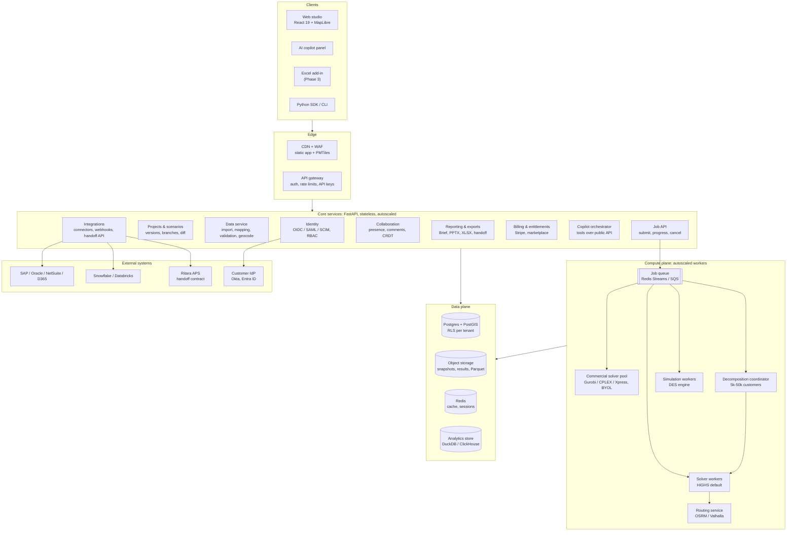
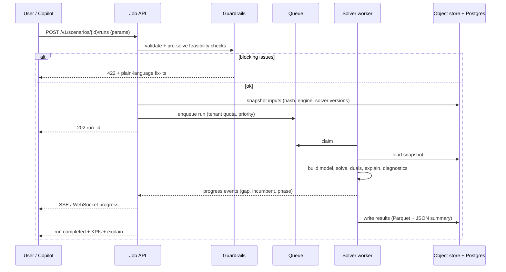
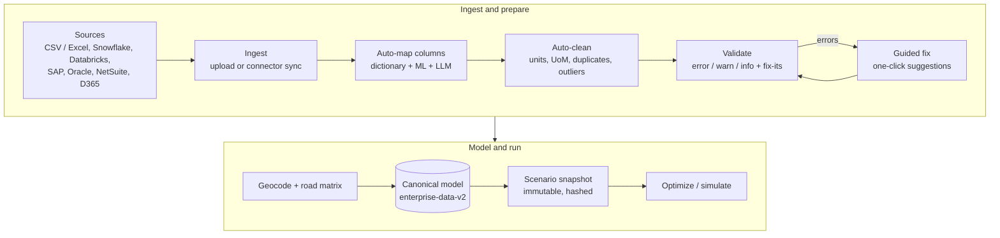
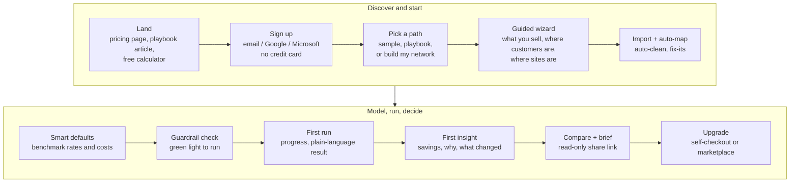
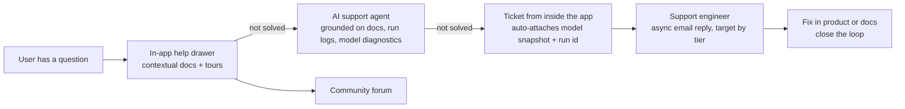
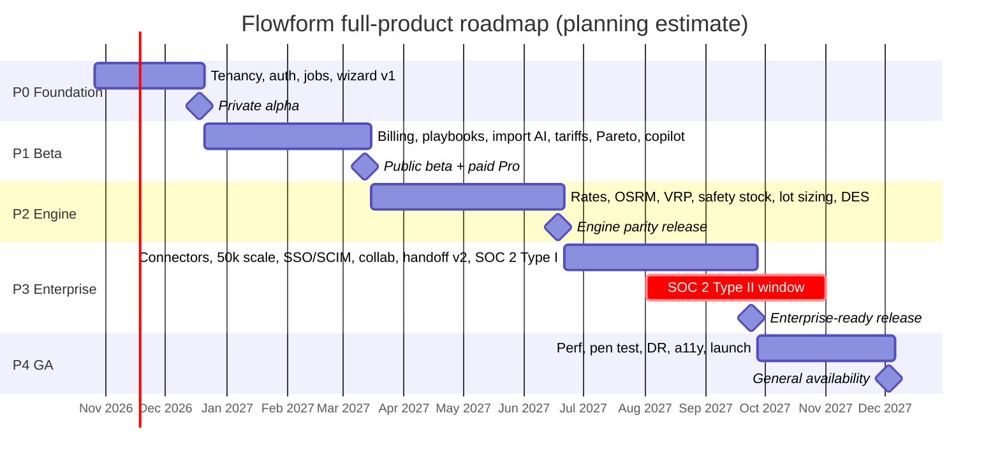

# Flowform — Full-Product Implementation Plan

**From strong demo to commercial-grade, self-serve supply-chain network design SaaS**

| | |
|---|---|
| **Document** | `docs/IMPLEMENTATION_PLAN.md` (Word copy: `docs/Flowform_Implementation_Plan.docx`) |
| **Author / owner** | Jigar Parekh (Product) |
| **Date** | October 18, 2026 |
| **Repo baseline** | `jigarparekh84-lab/Flowform` (private) · `master` @ `0878ad0` (*docs: refresh workbook*) · API `0.7.0` |
| **Companions** | [`MASTER_BLUEPRINT.md`](MASTER_BLUEPRINT.md) (what exists) · [`MANUAL_TEST_WORKBOOK.md`](MANUAL_TEST_WORKBOOK.md) (199 manual cases, 16 regression checks) · [`SMOKE_CHECKLIST.md`](SMOKE_CHECKLIST.md) |
| **Status** | Plan of record, v1. Estimates are planning estimates (±25 %) and are labelled as such. |

> **How the current state was checked.** Section 2 was read from the repository at `0878ad0`: README, `docs/MASTER_BLUEPRINT.md`, `docs/MANUAL_TEST_WORKBOOK.md`, the `apps/api` and `apps/web` trees, `requirements.txt`, `package.json`, and `.github/workflows/ci.yml`. Nothing in the code was changed. Peer capabilities (section 3) come from public vendor documentation, linked inline and listed in Appendix A.

## Contents

1. Executive summary and product definition
2. Current state (verified at `0878ad0`)
3. Peer calibration and differentiation
4. Capability gap matrix
5. Target architecture
6. Self-serve and no-consultant UX
7. Module requirements and acceptance criteria
8. Low-touch operating model
9. Phased roadmap
10. Quality plan
11. Team, tooling, cost, and build-vs-buy
12. Risks, mitigations, and readiness KPIs
13. Next 2–4 weeks: sprint backlog
14. Appendix A: sources · Appendix B: glossary

---

## 1. Executive summary and product definition

### 1.1 Summary

Flowform today is a **strong single-user demo**. It has a real optimization core: a fixed-charge, multi-echelon MIP (PuLP + HiGHS) with multi-SKU, BOM, capacities, hard service, lane modes, real duals, counterfactual explain cards, multi-period NPV on the Run basis, robust/stochastic design comparison, and infeasibility root-cause probes. It is wrapped in a 12-room, map-first React studio. Everything lives in the browser's `localStorage`. There is no server persistence, no tenancy, no auth, no job queue, and no testing past 200 customers.

The plan takes Flowform to a **full commercial product** in about **58 calendar weeks (≈ 13.5 months) and ≈ 460 engineer-weeks (range 385–550)**, across five phases. The product competes on modeling depth with Coupa Supply Chain Modeling (Supply Chain Guru X / LLamasoft), Optilogic Cosmic Frog, AIMMS SC Navigator, anyLogistix, and the Kinaxis and o9 network-design modules.

Its strategy differs from most of those peers in one deliberate way:

> **Flowform is a web-based, self-serve, low-touch SaaS.** A supply-chain planner or analyst can sign up, build a credible model, run it, understand the result, and hand it off to planning **without a consultant, a sales call, or a kickoff meeting**. The target is **time to first insight under 30 minutes**. Go-to-market, onboarding, support, customer success, and even enterprise procurement are designed to run asynchronously and mostly automatically (section 8).

The phases are ordered to serve that strategy. **Multi-tenant web, auth, server persistence, and self-serve onboarding come first (Phase 0–1).** Engine depth (transportation, inventory, simulation) follows in Phase 2, enterprise scale and self-serve enterprise features in Phase 3, and GA hardening in Phase 4.

### 1.2 What "full software" means (definition of done for the product)

Flowform counts as "full software", not a demo, when **all** of the following are true:

1. **Real SaaS.** Multi-tenant, authenticated web application. Projects, scenarios, and results live server-side, are versioned, survive browser changes, and can be shared with access control.
2. **Self-serve end to end.** A new user goes from sign-up to a solved, explained, compared scenario with no human help: guided wizard, auto-mapped import, smart defaults, guardrails, plain-language explanations, AI copilot. Billing, plan changes, SSO setup, and data connectors are self-service.
3. **Engine parity on the core questions.** Network MIP with inventory and safety stock, seasonality and multi-period capacity, production and lot sizing, tariffs, duties and landed cost, and multi-objective (cost / service / CO₂) with a Pareto front. Transportation rate engines (TL/LTL/parcel), road distances, milk-runs. A real discrete-event simulation of policies.
4. **Scale.** 5,000 customers solve interactively (minutes). 50,000 customers solve via aggregation and decomposition inside a published runtime and gap budget.
5. **Enterprise-ready without field sales.** SSO/SAML/OIDC, SCIM, RBAC, audit log, encryption, data residency (US/EU), SOC 2 Type II, trust center, DPA and procurement packet downloadable, marketplace listings (AWS/Azure).
6. **Integrated.** CSV/Excel plus warehouse connectors (Snowflake, Databricks) plus ERP extracts (SAP, Oracle, NetSuite, D365). A versioned, schema-validated handoff contract to Ritara (the downstream planning APS) and to other planning systems.
7. **Operable.** Observability, SLOs, on-call, disaster recovery, a published status page, solver regression benchmarks in CI, and a release train.

### 1.3 Target customers

| Segment | Profile | Why self-serve Flowform wins |
|---|---|---|
| **Primary: mid-market manufacturers and distributors** | $200M–$5B revenue, 2–40 facilities, 1–5 supply-chain analysts, no in-house OR team | Peer suites are priced and delivered for large enterprises with services. These teams need answers in days and cannot fund a consulting engagement for every question. |
| **Secondary: enterprise network-design / CoE teams** | Fortune 1000 teams with modelers | They want a faster "sketch-to-answer" tool next to their heavy suite, team collaboration, and a clean handoff to planning |
| **Tertiary: 3PLs, freight brokers, boutique consultants, academia** | Need many quick studies for many clients | Templates, a per-project workspace, and transparent per-seat pricing |

### 1.4 Personas

| Persona | Job to be done | Must succeed without help at |
|---|---|---|
| **Supply-chain planner / analyst** (primary user) | "Tell me which DCs we need and what it saves." | Wizard → import → Run → read explain → compare → brief |
| **Network design lead** | Owns the study and recommends a footprint | Scenarios, Pareto, robust, roadmap, brief |
| **Finance / CapEx partner** (reviewer) | Trusts the NPV and CapEx phasing | Read-only brief, NPV breakdown, assumptions |
| **Ops strategy / IBP reviewer** | Challenges risk and service | Sensitivity, simulation, resilience |
| **Data engineer / IT admin** | Connects data and configures SSO | Connectors, mapping templates, SSO / SCIM self-setup, API keys |
| **Downstream planner** (Ritara / S&OP) | Receives the design | Handoff package and API |
| **Procurement / security reviewer** (buyer side) | Approves the vendor | Trust center, SOC 2 report, DPA, questionnaire answers, all downloadable |

### 1.5 Core use cases (each ships as a templated playbook)

| # | Use case | Key engine features |
|---|---|---|
| U1 | **Greenfield / center-of-gravity** | Candidate generation, MIP site selection, service radius |
| U2 | **Footprint rationalization / consolidation** | Open/close/expand, fixed + variable cost, capacity, closure costs |
| U3 | **M&A integration / divestiture** | Merge networks, conflict resolution, synergy waterfall |
| U4 | **Nearshoring / tariffs / landed cost** | Duty rates by HS / origin / destination, FTA rules, landed-cost objective, tariff sensitivity |
| U5 | **Sustainability / CO₂** | Emission factors, carbon price, CO₂ cap, cost–CO₂ Pareto |
| U6 | **Capacity expansion and CapEx timing** | Multi-period NPV, seasonality, monthly capacity, lot sizing |
| U7 | **Transportation strategy / fleet** | Rate engines, mode choice, milk-runs, private vs common fleet |
| U8 | **Inventory positioning** | Multi-echelon safety stock, service levels, inventory carrying cost inside the MIP |
| U9 | **Resilience / risk** | Disruption scenarios, robust design, simulation, risk score |

### 1.6 Non-goals (unchanged)

Flowform is **not** an APS, scheduler, MRP, or TMS. Day-to-day planning stays in Ritara (or another planning system), which consumes Flowform's handoff contract. No Ritara source or internals are used or referenced. The integration is contract-only.

---

## 2. Current state (verified at `0878ad0`)

> **Historical snapshot.** This section describes `0878ad0` and predates FF-101…FF-119 and the hardening pass. Current state, endpoints, tests and limits are in [`MASTER_BLUEPRINT.md`](MASTER_BLUEPRINT.md) §3.3, §6 and §9. Where the two disagree, the blueprint wins.

### 2.1 Stack and layout

| Area | Verified state |
|---|---|
| Web | Vite 8 + React 19 + TypeScript 6, MapLibre GL 6; dev server **:5180** (strict), preview :5181. About **28.8k lines** of TS/TSX in `apps/web/src`. `FlowformContext.tsx` (single state store) plus 25 components (Compare is the largest) and 33 domain modules in `src/data`. |
| API | FastAPI **0.7.0** on **:5182**, PuLP + HiGHS (`highspy`), CBC fallback. `app/solver.py` **3,006 lines**, plus `explain.py`, `diagnostics.py`, `multi_period.py`, `multi_period_run.py` (Run-basis roadmap), `stochastic.py`. |
| Endpoints | `GET /health`, `POST /optimize`, `POST /optimize/explain`, `POST /optimize/multi-period`, `POST /optimize/stochastic`. All are **synchronous**. |
| Persistence | Browser `localStorage` only (`flowform-projects-index`, `flowform-project-<id>`, `flowform-theme`). |
| Map | MapLibre + **OpenFreeMap** (default) or Carto raster (`VITE_BASEMAP=carto`). SVG schematic fallback. |
| Tests | API: 11 test files, 77 test functions → **79 passed** (workbook SET-05). Web: `test:data` (enterprise 12/12, CTS 2/2, defect fixes). Manual: **20 workflows / 199 cases + 16 regression checks** (`MANUAL_TEST_WORKBOOK.md` + `.xlsx`). |
| CI | GitHub Actions: `npm ci && npm run build` (web), `pip install && pytest -q` (api). **It does not run** `test:data`, lint, type-check of the API, or benchmarks. |
| Packaging | `docker-compose.yml` (web + api), Dockerfiles for both. |
| Data | `enterprise-data-v1` pack with 38 validation codes and a scorecard. Samples: `na-footprint-2027.flowform.json`, stress-120 and stress-200 packs (generated by `scripts/generate-stress-packs.mts`). |
| Exit | `flowform.handoff.v1` JSON + Markdown ops brief. It is a **contract stub** toward Ritara. There is no live API. |

### 2.2 Rooms

Projects · Network · Greenfield · Hubs · Territory · Roadmap · Scenarios · Compare (14 tabs) · Brief · Data · Merge · Handoff.

### 2.3 Engine capabilities (verified)

- **Fixed-charge multi-echelon MIP:** supplier → plant (BOM `qtyPerUnit`) → DC → customer, plus plant → customer. Open/close binaries, CapEx + OpEx, min/max throughput, CapEx budget, max DCs and optional max plants, soft unmet-demand penalty or hard service, max lead time.
- **Multi-SKU / product groups:** auto-aggregation above 8 commodities, facility capability, group capacity.
- **Lanes:** capacity, multi-mode choice (Truck / Rail / Intermodal …) with $/unit, transit, CO₂, capacity, and fixed activation charge. Lane duals; binding-lane highlighting.
- **Explainability:** objective breakdown, real HiGHS capacity duals (LP with binaries fixed), counterfactual re-solve per facility (flip cost), ranked reasons, infeasibility root cause via relaxation probes (`MIN_THROUGHPUT_CONFLICT`, `LANE_CAPACITY_CONFLICT`, and others).
- **Multi-period NPV roadmap** on the Run basis: choose timing or force timeline. Y0 equals Run.
- **Robust / stochastic:** expected, minimax, and CVaR-lite over 2–5 scenarios via candidate-design enumeration, plus EVPI.
- **Client-side engines:** heuristic fallback, DES-lite (Monte Carlo), cost tornado and Monte Carlo, inventory policy (ASCM / z·σ·√LT, *outside* the MIP), resilience SPOF, territory, hub-spoke, lane bids, cost-to-serve, merge, CO₂ from unit weights.
- **Reference numbers:** sample Run **$98.27M**, 100 % service, Reno closed. Stress-200 **$176.81M**, 9 open, 6 binding lanes, ≈ 0.85–1.35 s.

### 2.4 Confirmed gaps (input to the gap matrix)

| # | Gap | Evidence |
|---|---|---|
| G1 | Single-user, browser-only persistence; no tenancy or auth | Blueprint §3.3, §11.1 #6, #9 |
| G2 | Collaboration stubs: Share link has no receiver, comments are local, ⌘K and "+ New" are stubs | §11.1 #6 |
| G3 | Synchronous solves; no job queue, cancellation, or progress | `main.py` endpoints |
| G4 | Inventory and safety stock not in the optimizer | `inventoryPolicy.ts` is client-side |
| G5 | No TL/LTL/parcel rate engines; straight-line distances; no road routing | `geo.ts`, Greenfield "Euclidean" |
| G6 | No tariffs / duties / landed cost in the optimizer (only a sensitivity preset) | Scenarios "Tariff / duty" preset |
| G7 | No seasonality, monthly capacity, or production lot sizing; multi-period growth is uniform | §11.1 #2 |
| G8 | DES-lite is Monte Carlo, not a discrete-event simulation | `desLite.ts` |
| G9 | Greenfield and composed scenarios are mock heuristics, not the MIP | §11.1 #8 |
| G10 | Supplier lanes have no mode choice | §11.1 #3 |
| G11 | Untested beyond 200 customers; no decomposition | stress packs |
| G12 | No ERP or data connectors (CSV templates and JSON pack only) | Data room |
| G13 | Basemap must move to self-hosted Protomaps PMTiles before launch | §11.1 #7 |
| G14 | No onboarding, templates beyond the sample, analytics, billing, or help system | — |
| G15 | Handoff is a stub (no schema registry, no API, no versioning policy) | §4.4 |
| G16 | CI does not run web data tests, lint, or benchmarks; large-chunk build warning | `ci.yml` |

---

## 3. Peer calibration and differentiation

### 3.1 What peers ship (from public documentation)

| Peer | Calibrated capabilities | Delivery model signals |
|---|---|---|
| **Coupa Supply Chain Modeling (Supply Chain Guru X, ex-LLamasoft)** | Licensable capabilities: Core Network Modeling, Site Capacity Planning, **Taxes & Duties**, Financial Modeling, Reverse Logistics, Cost to Serve, **Inventory Strategy**, Shelf Life, **Transportation Optimization** incl. fleet sizing ([Modeling capabilities](https://help.llama.ai/release/native/modeling/modeling-topics/Modeling_Capabilities.htm)). Engines: Network Optimization, **NO Decomposition** for large models, Greenfield, Infeasibility Diagnosis, VRP, Driver Scheduling, Safety Stock and Service Level Optimization ([Design engines](https://help.llama.ai/release/native/modeling/modeling-topics/Design_Engines.htm)). Discrete-event **simulation** with MRP and state management ([Simulation](https://help.llama.ai/release/native/modeling/modeling-topics/Using_Simulation.htm)). | Enterprise suite, modeler-centric; capabilities licensed per module ([Coupa](https://www.coupa.com/products/supply-chain-optimization/network-optimization/)) |
| **Optilogic Cosmic Frog** | Neo (network optimization), Throg (DES), Dendro (simulation-optimization with a genetic algorithm, e.g. inventory policy) ([Dendro](https://optilogic.com/resources/help-center/docs/getting-started-with-dendro)), Hopper (multi-stop routing) runnable **within** Neo ([NTO](https://optilogic.com/resources/help-center/docs/network-transportation-optimization-neo-hopper)), automatic risk rating, tariff and tax, M&A, sustainability, Leapfrog AI assistant, Excel front end ([Cosmic Frog](https://optilogic.com/platform/cosmic-frog)) | **Free account with sample models** and AI model building ([FAQ](https://optilogic.com/resources/post/cosmic-frog--top-11-faqs)), but also a professional-services team ([Solutions team](https://optilogic.com/professional-services)) and a consultant partner program ([Cosmic Reach](https://optilogic.com/resources/post/optilogic-launches-cosmic-reach--the-industrys-first-supply-chain-design-solution-tailored-to-management-consultants)) |
| **AIMMS SC Navigator** | Basic / Advanced network design, custom objectives (multi-objective, risk indexes), center of gravity, inventory optimization, batch Scenario Navigator ([SC Navigator](https://www.aimms.com/network-design/), [Scenario Navigator](https://scnavigator-manual.aimms.com/sc-navigator/sc-navigator-application/scenarios/index.html)), **percentage-based tariffs** (volume × value × rate) ([tariff guide](https://community.aimms.com/sc-navigator-best-practices-82/how-to-optimize-for-tariffs-in-sc-navigator-1920)) | SaaS, Excel templates, LLamasoft model converter, "project support with certified AIMMS partners" |
| **anyLogistix** | Greenfield (multi-echelon), network optimization on **CPLEX**, one-click conversion of optimization results to **dynamic simulation**, safety-stock estimation, **last-mile / milk-run** routing, GIS with **actual road paths** ([features](https://www.anylogistix.com/features/), [datasheet](https://www.anylogic.com/upload/alx-white-papers/anylogistix-technical-datasheet.pdf)) | Desktop + cloud; training- and consulting-led |
| **Kinaxis Network Design by 4flow / o9** | Kinaxis NWD: network modeling, visualization, center of gravity, inventory allocation, CO₂ and pollutant tracking, Maestro data sync ([4flow announcement](https://www.4flow.com/insights-events/4flow-in-the-news/center/new-network-design-application-for-maestro), [4flow apps](https://www.4flow.com/supply-chain-software/kinaxis-applications)). o9: scenario-driven design inside a planning platform (third-party summary: [statpit](https://statpit.com/best/supply-chain-network-design-software/)). | Modules inside large planning platforms; sold to existing platform customers |

### 3.2 Where Flowform already stands out

- **Explainability is already better than typical.** Per-facility counterfactual flip cost, real duals, and ranked plain-language reasons. Most peers expose output tables and leave interpretation to the modeler.
- **Map-first, scenario-native UX** with Compare (14 tabs), Brief, and Handoff exit ramps.
- **Design-to-planning contract** (`flowform.handoff.v1`) built in from the start.

### 3.3 Differentiator: built to be used without consultants

Most incumbents assume a trained modeler plus vendor or partner services: module licensing, partner-led implementation, and professional-services teams. Optilogic has moved furthest toward self-serve (free account, templates, AI model building). So **self-serve by itself is not unique, and the plan does not claim it is.** Flowform's differentiation is the *combination*:

1. **No modeler required.** A question-driven wizard, smart defaults, and guardrails make an infeasible or garbage model hard to build. Every number gets a plain-language explanation.
2. **Transparent pricing with self-checkout and a free tier.** No "contact sales" gate for any tier below custom enterprise terms.
3. **Low-touch enterprise.** SSO, SCIM, connectors, trust center, DPA, and SOC 2 report are all self-service. Marketplace procurement is available.
4. **Planner-sized scope.** Focused on network design questions and the handoff to planning, rather than a sprawling suite.

---

## 4. Capability gap matrix

Legend: ● full · ◐ partial · ○ none. **Peers** is a composite of the products in §3.1 (best-in-class shown). **Phase** is where the gap closes (section 9).

| Module | Capability | Flowform today | Target (GA) | Peers | Phase |
|---|---|---|---|---|---|
| **Platform** | Multi-tenant SaaS, server persistence | ○ localStorage | ● Postgres/PostGIS, tenants, versioned | ● | P0 |
| | Auth, SSO/SAML/OIDC, SCIM, RBAC | ○ | ● self-configured | ● | P0 (OIDC) → P3 (SAML/SCIM) |
| | Async jobs, parallel scenarios | ○ sync | ● queue + autoscaled workers | ● (Cosmic Frog: hundreds in parallel) | P0 |
| **Self-serve** | Onboarding wizard, templates, sample projects | ◐ one sample | ● wizard + 8 playbooks | ◐ (Optilogic templates) | P0–P1 |
| | Auto-mapping import, auto-clean, fix-its | ◐ 38 validation codes | ● mapping AI + auto-fix | ◐ | P1 |
| | Smart defaults (benchmark rates and costs) | ◐ cost scaling | ● public benchmark library | ○–◐ | P1 |
| | AI copilot (build / run / explain) | ○ | ● | ◐ (Leapfrog AI) | P1 → P2 |
| | Billing, trials, plan tiers | ○ | ● Stripe + marketplace | ○ (mostly sales-led) | P1 |
| **Data & modeling** | Canonical schema | ● enterprise-data-v1 | ● v2 + JSON Schema registry | ● | P1 |
| | Connectors (Excel, Snowflake, Databricks, ERP) | ◐ CSV/JSON | ● | ● | P1 (Excel) → P3 |
| | Geocoding | ○ lat/lng required | ● batch geocoder | ● | P1 |
| **Optimization** | Fixed-charge multi-echelon MIP | ● | ● | ● | — |
| | MIP-driven greenfield | ○ mock | ● | ● | P1 |
| | Tariffs / duties / landed cost | ○ preset | ● HS × origin × dest, FTA, %-of-value | ● (Coupa, AIMMS, Optilogic) | P1 |
| | Seasonality, monthly capacity, multi-period | ◐ yearly NPV | ● monthly buckets, pre-build | ● | P1 |
| | Production / lot sizing, lines | ○ | ● | ● | P2 |
| | Inventory + safety stock in MIP | ○ client-only | ● service-level-driven | ● | P2 |
| | Multi-objective + Pareto | ◐ carbon price | ● ε-constraint Pareto | ● (AIMMS custom objectives) | P1 |
| | Robust / stochastic | ◐ design enumeration | ● two-stage + sampling | ◐ | P2 |
| | Scale (5k–50k customers) | ○ 200 tested | ● decomposition + aggregation | ● (NO Decomposition) | P3 |
| | Commercial solver adapters | ○ HiGHS / CBC | ● Gurobi / CPLEX / Xpress (bring your own license) | ● | P3 |
| | Infeasibility diagnosis | ◐ probes | ● IIS + probes + guided fix | ● | P1 |
| **Transportation** | Rate engines (TL / LTL / parcel) | ○ $/unit lanes | ● | ● | P2 |
| | Road distances / times | ○ straight-line | ● OSRM / Valhalla | ● | P2 |
| | Milk-run / VRP / fleet | ○ | ● | ● (Hopper, Coupa TO, aLX) | P2 |
| **Simulation** | Discrete-event simulation of policies | ◐ DES-lite MC | ● DES engine + sim-opt lite | ● | P2 |
| **Scenarios** | Branching, versioning, batch runs | ◐ local list | ● server-side branches, diff, batch | ● | P0–P1 |
| **Explainability** | Explain cards, counterfactuals | ● | ● + plain-language everywhere | ◐ | P1 |
| **Visualization** | Map | ◐ OpenFreeMap | ● self-hosted Protomaps, road paths, flows at scale | ● | P0 / P2 |
| **Collaboration** | Share, comments, real-time | ○ stubs | ● links, comments, presence, approvals | ◐ | P1 → P3 |
| **Governance** | Audit log, approvals | ◐ local decision log | ● immutable server audit | ● | P1 → P3 |
| **Integrations** | Ritara / planning handoff | ◐ JSON stub | ● versioned contract + API + webhooks | ● (Kinaxis sync) | P1 → P3 |
| **Security** | SOC 2, encryption, residency | ○ | ● SOC 2 Type II, US/EU | ● | P3–P4 |
| **Risk** | Risk scoring | ◐ SPOF | ● risk score per scenario | ● (Cosmic Frog) | P2 |

---

## 5. Target architecture

### 5.1 Principles

- **API-first.** Every UI action maps to a documented public REST endpoint (OpenAPI 3.1). The web app, AI copilot, CLI/SDK, and integrations all use the same API.
- **Evolve the repo; no rewrite.** The existing `solver.py`, `explain.py`, `diagnostics.py`, `multi_period_run.py`, and `stochastic.py` become a **solver library** (`flowform-engine`) called by workers. The React rooms stay. `FlowformContext` gradually moves from `localStorage` to a server-synced store.
- **Tenant isolation by default.** Every row carries `tenant_id`, enforced by Postgres Row-Level Security. Each tenant has its own object-storage prefix and KMS data key.
- **Deterministic, reproducible runs.** Each run stores its input snapshot hash, engine version, solver version, parameters, and seed.

### 5.2 System diagram

### 5.3 Solve job lifecycle

### 5.4 Components and choices

| Concern | Choice | Notes |
|---|---|---|
| **Database** | Postgres 16 + **PostGIS**, Row-Level Security by `tenant_id` | Projects, scenarios, versions, runs, audit, entitlements. Spatial queries (radius, territory) in PostGIS. |
| **Object storage** | S3-compatible (S3 / Azure Blob / GCS) | Input snapshots and results as Parquet (columnar, fast Compare). Per-tenant prefix and KMS key. |
| **Queue + workers** | Redis Streams (Arq) to start; SQS / Service Bus in cloud. Workers on Kubernetes with KEDA autoscaling on queue depth | Per-tenant concurrency quotas by plan tier. Cancellation and time limits. Spot/preemptible nodes for batch runs with checkpoint/retry. |
| **Solver strategy** | **HiGHS default** (MIT license, already integrated). A `SolverAdapter` interface over PuLP is first refactored to direct `highspy` and later to a modelling layer (Pyomo / linopy evaluated in P1). **Gurobi / CPLEX / Xpress adapters** run in an isolated pool, **bring-your-own-license** first and resold later if demand appears. | Commercial solvers are an Enterprise option, never a dependency. Optimality gap and time limit are user-visible. |
| **Scale strategy** | (1) Customer **aggregation** (3-digit ZIP / H3 hexes, k-means) with disaggregation; (2) **arc pruning** by radius, lead time, and dominance; (3) **decomposition**: region / product-group decomposition with a coordinating master, plus Benders for open/close × flows; (4) **heuristics**: LP-relaxation rounding, fix-and-optimize, local search to warm-start the MIP | Targets in §10.3: 5k customers interactive, 50k customers batch. |
| **Routing / distance** | **OSRM** (truck-profile, self-hosted, per-region extracts) for distance/time matrices; **Valhalla** where truck attributes or time-dependence are needed. Cached matrices in Postgres/Parquet; great-circle × circuity factor as fallback | Road-path geometry for map display. |
| **Simulation engine** | Python DES on **SimPy** for v1 (orders, inventory policies, transport, capacity), vectorized replications on workers; profile and port hot loops to Rust/Numba if needed | Fed from optimizer output ("convert design to simulation"). |
| **Data pipeline** | Import → map (auto-mapping) → clean (rules + suggestions) → validate (38 codes → v2 registry) → geocode → canonical model (enterprise-data-v2) → snapshot. **DuckDB** for in-worker transforms. Connectors via an **Airbyte**-compatible connector framework or a managed ELT provider for ERP sources | Connectors run in the customer's region. |
| **API** | FastAPI, OpenAPI 3.1, `/v1` versioning, API keys + OAuth2, idempotency keys, webhooks | Generated TypeScript client for the web and a Python SDK. |
| **Auth** | Managed identity (WorkOS / Auth0 / Entra External ID class) for SSO/SAML/OIDC, **self-serve SSO admin portal**, SCIM. App-level RBAC (Owner, Admin, Modeler, Reviewer, Viewer, Billing) + project-level ACLs | Email magic link and Google/Microsoft for self-serve tiers. |
| **Audit** | Append-only `audit_events` (who, what, when, before/after hash), exportable, retained per plan; extends today's decision log | Feeds SOC 2 evidence. |
| **Collaboration** | Server-side scenario branching (copy-on-write versions), comments with @mentions, presence; real-time co-editing of model tables via **Yjs CRDT** in Phase 3 | Approval workflow for "recommended" scenarios. |
| **Reporting** | Brief → HTML / PDF / **PPTX** / XLSX; scheduled exports; embeddable read-only share links | |
| **Observability** | OpenTelemetry traces/metrics/logs → Grafana stack or Datadog; Sentry for errors; solver telemetry (model size, gap curve, time) | SLOs in §12.2. |
| **Security & compliance** | TLS 1.2+, AES-256 at rest, per-tenant KMS keys (BYOK for Enterprise), secrets in a vault, SSO enforcement, IP allow-lists, US and EU **data residency** (separate regional stacks), SOC 2 Type I → II, GDPR DPA, pen test yearly | Trust center (section 8). |
| **Product analytics** | PostHog (self-hosted or EU cloud) event pipeline: funnels, drop-off, feature flags, session replay (opt-in, PII-masked) | Drives the self-serve KPIs. |
| **Deployment** | Terraform, Kubernetes (EKS or AKS), Helm, GitHub Actions → staging → prod (blue/green). Single-tenant VPC deployment as a later Enterprise option | Same images as today's Docker Compose for local dev. |

### 5.5 Data pipeline

---

## 6. Self-serve and no-consultant UX

**Design principle (applies to every module):** *A supply-chain planner with spreadsheet skills and no optimization background can complete a credible network study alone.* Any feature that needs a consultant to configure or interpret is incomplete.

### 6.1 Self-serve journey

### 6.2 Requirements and acceptance criteria

| ID | Requirement | Acceptance criteria |
|---|---|---|
| **SS-01 Sign-up and trial** | Sign up with email magic link or Google/Microsoft. 14-day full-feature trial, then Free tier. No credit card. Workspace created automatically. | Sign-up to studio in **≤ 60 s** and ≤ 3 screens. No human step. Trial state visible in-app. Trial-expiry emails automated. |
| **SS-02 Sample and template projects** | Gallery: NA Footprint 2027 (today's sample), EU distribution, nearshoring MX/US with tariffs, CO₂ reduction, M&A merge, DC consolidation, capacity expansion, last-mile milk-run | Each template opens solved with an annotated tour. Re-run reproduces the stored result to the cent (golden). |
| **SS-03 Question-driven model builder (wizard)** | Steps: (1) *What do you sell?* product families, unit weight/cube, value; (2) *Where are your customers?* upload / paste addresses, ZIPs, or pick regions plus demand; (3) *Where are your sites?* existing plants/DCs, costs if known; (4) *What question?* pick a playbook; (5) review defaults. | A user with only customer ZIPs + annual volume + existing DC addresses reaches a valid, runnable model in **≤ 15 min median** (usability test, n ≥ 8, no facilitator help). Every skipped field gets a labelled default. |
| **SS-04 Import with auto-mapping** | Upload CSV/XLSX (multi-sheet). Column auto-mapping (header dictionary + fuzzy match + LLM suggestion with confidence). Saved mapping templates per tenant and source system (e.g. "SAP VL06O extract"). | ≥ **90 %** of columns auto-mapped correctly on the 20-file benchmark corpus. The user confirms in one screen. Mappings are reusable. |
| **SS-05 Auto-clean and fix-it suggestions** | UoM normalization, duplicate merge, outlier flags, missing lat/lng → geocode, negative or zero capacities, orphan references. One-click fix or "accept all safe fixes". | All 38 existing validation codes (plus v2 additions) carry a plain-language message, a *why it matters* line, and a suggested fix. ≥ 80 % of errors in the benchmark corpus fixable in one click. |
| **SS-06 Smart defaults** | Public-benchmark library: freight rates by mode and distance band, DC fixed and variable cost by region, labor, inventory carrying %, emission factors (GLEC-aligned), duty rates (public tariff schedules). Every default shows source, date, and confidence. | No run is blocked by a missing *cost*. Defaults are tagged "assumed" in results and the Brief. Data refreshed at least quarterly, with a changelog. |
| **SS-07 Guardrails** | Pre-solve checks: reachability, capacity ≥ demand, units sanity (e.g. $/unit 1,000× off median), lead-time feasibility, budget vs mandatory opens; model-size estimate vs plan quota. **The Run button explains why it is disabled.** | 100 % of infeasible golden cases are caught **before** solve or diagnosed after, with a named root cause and a fix. No "Infeasible" ever shows without a next step. |
| **SS-08 Plain-language explanations of every result** | Every KPI, decision, and chart has a "Why?" with a template-generated sentence (deterministic, from explain/dual data) plus an optional copilot elaboration. Glossary hover for every term (dual, CVaR, EVPI). | Reviewer comprehension test: ≥ 80 % of non-OR participants correctly answer "why is DC X closed?" from the UI alone. |
| **SS-09 AI copilot** | Chat panel that can *build* (create sites, import, set constraints), *run* (scenarios, sensitivities), *explain* (results, infeasibility), and *draft* (brief). It acts only through the public API under the user's RBAC; every action is previewed and undoable; citations to data rows. | On a 50-task eval set: ≥ 85 % task success, 0 actions outside permissions, 100 % of mutations previewed. Hallucinated numbers = 0 (numbers must come from tool results). |
| **SS-10 Contextual help and tutorials** | In-app tours per room, a help drawer searching the docs, a 3-minute video per playbook, an empty-state guide everywhere. | Every room has an empty state with a next action. Docs search returns a relevant article for ≥ 90 % of the top-100 queries. |
| **SS-11 Playbooks** | Greenfield, consolidation, nearshoring/tariffs, CO₂, capacity expansion, M&A, inventory positioning, transport strategy. Each = template + wizard preset + scenario set + Brief outline. | Each playbook completes from blank to Brief in **≤ 30 min** on its sample data by a first-time user. |
| **SS-12 Time to first insight** | Instrumented funnel from sign-up → first model → first run → first "insight viewed" (explain card or compare). | **Median TTFI < 30 min**, p75 < 60 min, measured from analytics (section 12). |
| **SS-13 Self-serve billing and plan tiers** | Stripe Checkout and Customer Portal; plan upgrades/downgrades, seats, usage (solver-minutes) visible in-app; invoices; tax handled (Stripe Tax). Marketplace (AWS/Azure) private offers for Enterprise. | Purchase to unlocked entitlements in **< 2 min** with no human. Dunning and receipts automated. |
| **SS-14 Usage analytics and drop-off** | Event taxonomy (≈ 60 events), funnels per persona, cohort retention, feature adoption, error-to-churn correlation, in-app NPS / CSAT micro-surveys. | Weekly automated drop-off report. Each funnel step has an owner and a target. |
| **SS-15 Accessibility and internationalization** | WCAG 2.1 AA; units (metric/imperial), currency, locale; English at GA with an i18n framework ready. | axe-core CI clean on all rooms; keyboard-only completion of a playbook. |

### 6.3 What self-serve changes in the existing rooms

| Room | Change |
|---|---|
| Projects | Server-backed; template gallery; trial banner; import of existing `*.flowform.json` and localStorage migration |
| Network | Empty-state wizard launcher; "Why?" on every KPI; guardrail badge on Run |
| Greenfield | Becomes MIP-driven (G9); one-question setup ("how many DCs, max miles?") |
| Data | Becomes the import wizard: mapping → cleaning → validation → geocode; mapping templates |
| Compare / Brief | Plain-language summary generated first, tables second; PPTX export |
| Handoff | Schema-validated, versioned, send by API/webhook, not only download |

---

## 7. Module requirements and acceptance criteria

Requirement IDs are stable and referenced by the roadmap and the backlog. "Golden" means a versioned dataset with stored expected results (§10.2).

### 7.1 M1 — Data and modeling

| ID | Requirement | Acceptance criteria |
|---|---|---|
| DM-01 | **enterprise-data-v2** canonical schema (superset of v1): sites, products (weight, cube, value, HS code, shelf life), demand by period, lanes and rate references, BOM / routings, production lines, inventory policies, tariffs, emission factors, calendars | Published JSON Schema + Pydantic models. v1 packs upgrade losslessly (round-trip test on all samples). |
| DM-02 | Server-side validation registry: the 38 v1 codes + new codes, severity, message, hint, auto-fix | Same codes and levels as the client (`enterprisePack.test.ts` parity). Registry exposed at `GET /v1/validation-codes`. |
| DM-03 | Batch geocoding (addresses, ZIP/postal, city) with confidence, plus a manual pin fix on the map | ≥ 98 % match on the US/EU benchmark list; low-confidence items flagged as warn. |
| DM-04 | Time buckets: year, quarter, month, week; calendars; demand profiles and seasonality indices | Monthly model of stress-200 × 12 periods solves (see §10.3). |
| DM-05 | Units and currency: UoM conversions (units, cases, pallets, kg, m³), FX tables | Unit-weight CO₂ results equal today's (5.5 kt sample) after migration. |
| DM-06 | Data versioning: every edit creates a version; scenario = base version + deltas (today's `deltas` concept made server-side) | Diff between any two versions in < 2 s for 10k rows. |
| DM-07 | Large-data handling: 50k customers × 500 SKUs × 12 periods (≈ 300M potential demand cells, sparse) stored as Parquet; paged grids | Import of 1 GB CSV in < 10 min. Grid scroll at 60 fps. |

### 7.2 M2 — Optimization

| ID | Requirement | Acceptance criteria |
|---|---|---|
| OP-01 | **Engine refactor**: `flowform-engine` package (model builder, solver adapter, post-processors: duals, explain, diagnostics). Endpoints unchanged in `/optimize*` and also exposed as async jobs | All 79 pytest cases and REG-01…REG-15 values identical (to the cent) after refactor. |
| OP-02 | **MIP-driven greenfield**: candidate generation (center-of-gravity, k-means / p-median seeds, H3 grid, user list), MIP open decision with service radius | On the greenfield golden set, the cost is within 1 % of an exhaustive search over candidates (≤ 30 candidates). Replaces `generateCandidates` mock. |
| OP-03 | **Supplier-lane mode choice** (G10) | Supplier flows carry `laneId` / `mode`. Mode split chosen by the MIP. |
| OP-04 | **Tariffs / duties / landed cost**: duty = %-of-customs-value and/or per-unit by (HS code or product group, origin country, destination country); FTA eligibility rules (e.g. USMCA qualifying flag); de-minimis; duty drawback flag; landed-cost objective component and per-flow landed-cost breakdown | Nearshoring golden: moving sourcing CN→MX changes duty cost by the hand-computed amount (±$0.01M). Tariff sensitivity tornado on rates. Matches the AIMMS-style volume × value × rate convention. |
| OP-05 | **Multi-period seasonality**: monthly / quarterly buckets, period capacity, pre-build inventory linking periods, per-period budgets, per-SKU growth | 12-month model with a peak season builds inventory ahead of peak when capacity binds. Per-period budget enforced in all periods (today only Y0). |
| OP-06 | **Production and lot sizing**: production lines/resources with rates, setup cost/time, minimum lot, campaign (big-bucket capacitated lot sizing), make-vs-buy | Lot-sizing golden: setup trade-off verified against a brute-force small instance. |
| OP-07 | **Inventory and safety stock in the MIP**: cycle stock (Q/2), pipeline stock (flow × transit), safety stock via guaranteed-service-model approximation, piecewise-linear in pooled demand per DC (square-root law surrogate) for service level α; inventory carrying cost in the objective | Consolidating 2 DCs into 1 reduces safety stock ≈ by the √-pooling effect on the golden case (±5 %). Matches today's client ASCM calc when the network is fixed. |
| OP-08 | **Multi-objective**: weighted sum and **ε-constraint** across cost, service (% within X days), CO₂, risk; automatic **Pareto front** (5–15 points) with knee-point highlight | Pareto points are non-dominated (verified). Generated in parallel jobs. UI chart with a "pick a point → scenario" action. |
| OP-09 | **Robust / stochastic v3**: true two-stage SAA (sample average approximation) with 10–100 samples on aggregated models; current design-enumeration retained for small/fast cases; regret and CVaR objectives | SAA solution evaluated out-of-sample. The stability test shows the design is unchanged across 3 seeds on the golden case. |
| OP-10 | **Risk**: risk score per site/lane (country, natural hazard, single-source, concentration) as a constraint or objective; disruption scenarios | Each scenario shows a risk score with drivers. Resilience golden (Austin/Columbus critical) preserved. |
| OP-11 | **Infeasibility v2**: HiGHS/commercial IIS where available + existing relaxation probes → ranked root causes with **one-click fix** (relax X by Y) | All INF-* workbook cases produce a named root cause and a fix that makes the model feasible. |
| OP-12 | **Scale**: aggregation, arc pruning, decomposition, heuristics warm start (§5.4) | Benchmark targets in §10.3 met in nightly CI. |
| OP-13 | **Solver adapters**: HiGHS (default), Gurobi, CPLEX, Xpress behind one interface; same model, same results within gap tolerance | Cross-solver golden: objective within the configured MIP gap on all M/L instances. |
| OP-14 | **Run controls**: time limit, gap, warm start from the previous scenario, cancel, progress (incumbent, bound, gap curve) | Cancel stops within 5 s. Progress updates at least every 2 s. |

### 7.3 M3 — Transportation

| ID | Requirement | Acceptance criteria |
|---|---|---|
| TR-01 | **Road distance/time service**: OSRM truck profile for NA and EU extracts, matrix API with caching; great-circle × circuity fallback flagged as "estimated" | 1,000 × 1,000 matrix in < 60 s, cached thereafter. Results show the distance basis. |
| TR-02 | **TL rate engine**: $/mile by lane or region pair, minimum charge, fuel surcharge (DOE index table), accessorials | Recomputes lane $/unit from shipment profile (units per load from weight/cube). Unit tests per rule. |
| TR-03 | **LTL rate engine**: class / weight-break tariffs (CzarLite-style base rates imported by the customer, or benchmark defaults), discounts, minimums | Golden shipments rated to the cent against the imported tariff. |
| TR-04 | **Parcel rate engine**: zone charts, dimensional weight, surcharges (residential, DAS) from imported carrier tables | Zone lookup and dim-weight tests. |
| TR-05 | **Shipment profiling**: demand → shipment size distribution → mode choice (parcel / LTL / TL / intermodal) as a cost function feeding the MIP (piecewise-linear) | Mode selection by size band is visible in results. |
| TR-06 | **Milk-run / VRP**: OR-Tools CVRPTW for outbound multi-stop routes; "route after network" first, then "route-aware network" via route-cost columns | Routing golden (Solomon-like instance) within 3 % of best-known. Route maps drawn on road geometry. |
| TR-07 | **Fleet sizing**: private vs common carrier, vehicle types, fixed cost per vehicle, driver hours (simple HOS) | Fleet-size result on golden case equals brute-force. |
| TR-08 | **Rate benchmarks**: default rate library by mode and distance band with source and date | Covered by SS-06. |

### 7.4 M4 — Simulation

| ID | Requirement | Acceptance criteria |
|---|---|---|
| SIM-01 | **DES engine** (SimPy v1): orders (daily or order-line), inventory policies (s,S / R,Q / base-stock / min-max), replenishment lead times, production capacity, transport dispatch and consolidation rules, disruptions | Policy goldens versus analytical results (M/M/1, base-stock fill rate) within 2 %. |
| SIM-02 | **Design → simulation** one-click: build a sim model from an optimized scenario (sites, flows, safety stocks) | Converted model runs with no manual edits on all templates. |
| SIM-03 | Replications and statistics: N replications, CI on fill rate, OTIF, backorders, inventory, utilization, cost; time-series charts | 30 replications of stress-200 × 365 days in < 10 min on the worker pool. |
| SIM-04 | **Sim-opt lite**: search over policy parameters (safety stock multipliers, reorder points) with Bayesian optimization / GA | Improves the objective versus baseline policy on the golden case; reproducible with a seed. |
| SIM-05 | DES-lite stays as the instant "quick check" | REG-11 (fill 98 % / late 2 %) unchanged. |

### 7.5 M5 — Scenario management and Compare

| ID | Requirement | Acceptance criteria |
|---|---|---|
| SC-01 | Server-side scenarios: branch, rename, lock, archive, tag; lineage graph (base → deltas) | Branching a 50k-customer scenario in < 3 s (copy-on-write). |
| SC-02 | **Batch runs**: run N scenarios × M datasets in parallel; sensitivity sweeps (parameter grids) | 20-scenario batch of stress-200 completes in < 5 min. |
| SC-03 | Compare up to 10 scenarios (today: 5) with all 14 tabs on server-computed results; map diff | Compare loads in < 3 s from Parquet summaries. |
| SC-04 | Recommended scenario + approval (Reviewer sign-off) feeding Brief and Handoff | Audit entry on approve. Handoff uses only the approved version. |
| SC-05 | Exports: XLSX of all outputs, PPTX brief, CSV per table, API | Byte-stable exports for goldens (except timestamps). |

### 7.6 M6 — Explainability and AI copilot

| ID | Requirement | Acceptance criteria |
|---|---|---|
| EX-01 | Keep and extend explain v1 (counterfactuals, duals, reasons) to lanes, modes, tariffs, inventory, and periods | Explain card for every decision type. Counterfactual budget configurable. |
| EX-02 | **Plain-language narrative** generator (deterministic templates) for run summary, scenario deltas (waterfall), and infeasibility | Every number in the narrative traces to a result field (unit test). |
| EX-03 | **Copilot tools**: `create_project`, `import_file`, `map_columns`, `set_constraint`, `create_scenario`, `run`, `compare`, `explain`, `draft_brief`, `search_docs` | Eval suite (SS-09). Prompt-injection tests on imported data (data is never instructions). |
| EX-04 | Copilot safety: tenant data isolation, no training on customer data, model provider with zero-retention terms, per-tenant opt-out | Documented in the trust center. Red-team checklist passed. |
| EX-05 | "Ask why" anywhere: right-click any KPI, site, lane, or chart → explanation | Available in all rooms. |

### 7.7 M7 — Visualization and map

| ID | Requirement | Acceptance criteria |
|---|---|---|
| VZ-01 | **Self-hosted Protomaps PMTiles** basemap on own object storage + CDN, light/dark styles, "© OpenStreetMap" attribution ([Protomaps downloads](https://docs.protomaps.com/basemaps/downloads/), [about](https://protomaps.com/about)) | No third-party tile host at runtime. Attribution visible. Works offline-cached. |
| VZ-02 | Rendering at scale: 50k customer points (clustering / WebGL), 100k flow arcs (deck.gl-style layer or MapLibre custom layer), H3 heatmaps | 60 fps pan/zoom on a 2020 MacBook Air class device with 50k points. |
| VZ-03 | Road-path geometry for lanes and routes (from TR-01 / TR-06) | Toggle straight / road. |
| VZ-04 | Charts: Pareto, waterfall, tornado, time series, Gantt; consistent design system | Visual regression snapshots in CI. |
| VZ-05 | Fix the headless MapLibre worker warning; code-split the bundle (current > 500 kB chunk warning) | Build has no chunk warning. LCP < 2.5 s. |

### 7.8 M8 — Collaboration and governance

| ID | Requirement | Acceptance criteria |
|---|---|---|
| CG-01 | Workspaces, teams, project ACLs; RBAC roles (Owner, Admin, Modeler, Reviewer, Viewer, Billing) | Permission matrix tests (role × endpoint) 100 % covered. |
| CG-02 | Real share links (replaces the `flowform://share` stub): read-only, expiring, optional password/SSO-required | The link opens the exact scenario version. Revocation is immediate. |
| CG-03 | Comments with @mentions, resolve, email/in-app notifications (replaces local comments) | Notifications batched; digest emails. |
| CG-04 | Presence + real-time co-editing (Yjs) of model tables and map | Two users editing different rows converge with no loss (fuzz test). |
| CG-05 | Immutable audit log (extends the decision log) with export and retention settings | Every mutating API call writes an audit event (test enforces it). |
| CG-06 | Approvals: scenario → "Recommended" requires Reviewer approval when the workspace policy is on | Policy test. |

### 7.9 M9 — Integrations (incl. Ritara handoff contract)

| ID | Requirement | Acceptance criteria |
|---|---|---|
| IN-01 | **Files**: CSV, XLSX (multi-sheet), JSON pack; mapping templates | SS-04. |
| IN-02 | **Warehouses**: Snowflake and Databricks (read via service credentials or key-pair; query → snapshot), BigQuery later | Connector set up by the customer admin in < 15 min with docs only. |
| IN-03 | **ERP extracts**: SAP S/4HANA (OData / CDS views or standard extracts), Oracle EBS / Fusion, NetSuite (SuiteQL), Dynamics 365 SCM (Data Entities) — sites, materials, customers, sales history, BOM, lanes/freight | Each connector ships with a mapping template and a sample. Delivered via a connector framework or partner (build-vs-buy §11.4). |
| IN-04 | **Handoff contract `flowform.handoff.v2`**: JSON Schema published (and v1 kept), semantic versioning, compatibility policy (additive minor, breaking = major with 12-month overlap), signed package (SHA-256 + signature), delivery by download, `GET /v1/handoffs/{id}`, and **webhook push** to a registered planning endpoint (e.g. Ritara intake) | Contract tests: every package validates against its schema. v1 consumers keep working. The webhook retries with backoff and is idempotent. **No Ritara code is used; integration is contract-only.** |
| IN-05 | Handoff contents: approved design (sites with status and capacity by period), lanes with modes and rates, sourcing/territory assignments, CapEx calendar, product mix, BOM, safety stock and inventory targets by node-SKU, assumptions, scenario metadata, KPIs | Field coverage checklist versus today's v1 sections (overview, network, preferred lanes, territory, CapEx, products, BOM, inventory, scenarios). |
| IN-06 | Public REST API + Python SDK + webhooks (run completed, scenario approved, handoff published) | SDK examples run in CI against staging. |

### 7.10 M10 — Admin and billing (product capability)

| ID | Requirement | Acceptance criteria |
|---|---|---|
| AB-01 | Plans and entitlements: Free, Pro, Team, Enterprise; limits on customers per model, scenarios, solver-minutes, connectors, SSO | Entitlement checks server-side. Upgrade unlocks without re-login. |
| AB-02 | Stripe Billing: checkout, portal, seats, metered solver-minutes, tax, invoices, dunning | Automated end to end in staging test mode. |
| AB-03 | Marketplace: AWS Marketplace and Azure Marketplace SaaS listings with metering APIs and private offers | Test purchase provisions a tenant automatically. |
| AB-04 | Admin console: users, SSO (self-serve setup portal), SCIM, domains, data residency choice at workspace creation, retention, API keys, audit export | An admin configures Okta SAML + SCIM with no vendor contact. |
| AB-05 | Usage dashboards for admins (seats, solver minutes, storage) | Matches billing records. |

---

## 8. Low-touch operating model

**Strategy.** Flowform is run as a deliberately **low-touch, product-led** business. The product, documentation, and automation carry the work that peers assign to sales engineers, implementation consultants, and customer-success managers. Human interaction is never *required* to buy, start, use, or renew Flowform. Where it cannot be avoided, it is asynchronous and written.

### 8.1 Go-to-market

| Element | Low-touch design |
|---|---|
| **Pricing** | Public pricing page. No "contact sales" for Free, Pro, or Team. Enterprise has a published *starting* price and a self-serve quote builder. |
| **Tiers (hypotheses to validate in beta; estimates)** | **Free:** sample projects, up to 50 customers per model, 3 scenarios, HiGHS, community support. **Pro** (≈ $250–$500 / user / month): 2,000 customers, unlimited scenarios, playbooks, copilot, Excel import, 300 solver-minutes. **Team** (≈ $1,500–$3,500 / month, 5 seats): 10k customers, collaboration, connectors (warehouse), approvals, 2,000 solver-minutes. **Enterprise** (≈ $40k–$150k / year): 50k customers, SSO/SCIM, ERP connectors, audit export, data residency, BYO solver license, 99.9 % SLA. |
| **Purchase paths** | (1) Stripe self-checkout (card / ACH / invoice for annual). (2) **AWS / Azure Marketplace** listings and private offers, so customers can buy against committed cloud spend through their existing procurement. (3) Reseller/referral partners on a standard agreement. **No field sales team.** |
| **Demand generation** | Content-led and SEO: one in-depth playbook article per use case (greenfield, consolidation, tariffs, CO₂, M&A), annotated public sample models, benchmark reports from the smart-defaults library (e.g. quarterly freight-rate index), and **free mini-tools** (center-of-gravity calculator, landed-cost / tariff calculator, CO₂ per lane calculator) that convert to sign-ups. Webinars are pre-recorded. |
| **Community** | Public forum (Discourse) and template gallery for user-contributed models; an office-hours *thread* (async), not calls. |
| **Trials and conversion** | Automated: trial lifecycle emails tied to funnel events, in-app upgrade prompts at limits, usage-based nudges. |

### 8.2 Onboarding and implementation (zero-touch)

- **No kickoff meeting.** The workspace setup checklist (invite team, connect data, pick playbook, configure SSO) runs in-app with progress tracking.
- **Implementation = product features**: wizard (SS-03), import auto-mapping and saved templates (SS-04), connectors with self-serve setup guides (IN-02/03), smart defaults (SS-06), and guardrails (SS-07).
- **"Implementation kits"** per source system (e.g. SAP extract spec + mapping template + validation checklist) are downloadable documents, so the customer's IT can prepare data without talking to us.
- **Services through partners only.** Customers who want hands-on modeling help are routed to a **listed partner directory** (independent consultants, 3PL analysts). Flowform does not run a services practice; partners get free practitioner accounts and a referral fee.

### 8.3 Support (async only)

| Channel | Policy |
|---|---|
| In-app help, docs, tutorials, status page | All tiers. The docs site is versioned with releases (docs-as-code in the repo). |
| **AI support agent** | All tiers. Grounded on docs, the user's run log, and diagnostics. Can *read* the user's model with consent. Escalates with a full context bundle. Target ≥ 60 % deflection. |
| Ticket / email | Pro and above. First-response targets (business hours, estimates): Pro 1 business day, Team 8 h, Enterprise 4 h (P1: 1 h with on-call). |
| Community forum | All tiers. Moderated by the team plus volunteers. |
| Phone / video | **Not offered.** Screen recordings (Loom-style) are used for async walkthroughs when a written answer is not enough. |

### 8.4 Automated customer success

- **Health score** per workspace: active modelers, runs per week, scenarios compared, briefs exported, errors hit, seat utilization, and days since the last value event.
- **Lifecycle automation**: in-app nudges and emails triggered by health changes (e.g. "your import has 12 warnings — fix them in one click"; "you haven't compared scenarios — here's how"), renewal reminders, and expansion prompts at limits.
- **Product feedback loop**: weekly automated drop-off report (SS-14); top support themes become backlog items.

### 8.5 Self-serve enterprise (so enterprise deals close mostly async)

| Need | Self-serve answer |
|---|---|
| SSO / SCIM | Admin portal for SAML/OIDC + SCIM setup with IdP-specific guides (Okta, Entra ID, Google) |
| Security review | Public **trust center**: SOC 2 Type II report (click-through NDA download), pen-test summary, architecture and data-flow diagrams, subprocessor list, encryption, residency, incident policy, BCP/DR |
| Questionnaires | Pre-filled **CAIQ** and **SIG Lite** downloadable; custom questionnaires answered async with an AI-assisted answer library and human review |
| Legal | Click-through MSA for Free/Pro/Team. Enterprise: standard **order form + DPA (self-sign)**, a published **fallback-clause playbook** (pre-approved positions on liability caps, SLA credits, governing law) so redlines are resolved in writing |
| Procurement | **Procurement packet** (W-9, insurance certificates, banking letter, accessibility statement, VPAT, sample invoice, supplier forms) downloadable; marketplace purchasing removes new-vendor setup in many companies |
| Data and connectors | Self-serve connector setup with service-account instructions; customer-managed keys (BYOK) for Enterprise |

### 8.6 Minimal operating staff (post-GA; estimates)

| Role | FTE | Notes |
|---|---|---|
| Product owner / founder | 1 | Product, pricing, roadmap, final escalation |
| Engineering (core) | 4–6 | Product engineering; on-call rotation; owns docs-as-code |
| Support / solutions engineer (async) | 1 | Ticket queue, AI agent tuning, docs gaps; can be a contractor in year 1 |
| Content and SEO | 0.5 contractor | Playbooks, benchmark reports, mini-tools content |
| Security / compliance | 0.2–0.3 fractional | vCISO, SOC 2 program with an automation platform |
| Finance, legal, tax | fractional / outsourced | Bookkeeping, revenue recognition, contract templates |
| Community moderation | 0.2 | Shared by support and engineers |

### 8.7 Unavoidable interactions and how to keep them async

| Interaction | Why unavoidable | How it stays async |
|---|---|---|
| Large-enterprise security reviews with custom questions | Buyer policy | Trust center + answer library; written Q&A in a shared portal; a single scheduled call only if the buyer's policy mandates it |
| Contract redlines | Buyer legal | Standard paper, fallback playbook, e-signature; redlines exchanged in documents |
| SOC 2 audit fieldwork | Auditor requirement | Compliance-automation platform evidence; auditors that support remote, document-based fieldwork; few, scheduled walkthroughs |
| Incidents and outages | Customer impact | Status page, email notifications, written post-mortems |
| Complex model bugs | Product defects | Ticket auto-attaches the snapshot; reproduce from the snapshot; written resolution or screen recording |
| Marketplace / partner onboarding | Platform rules | Mostly portal-based; standard partner agreement |
| Payment disputes, legal requests | Rare | Email; handled by the fractional finance/legal provider |

---

## 9. Phased roadmap

**Reprioritization.** The self-serve strategy moves multi-tenant web, auth, persistence, onboarding, telemetry, and billing **ahead of** engine depth. Revenue (Pro tier) and real usage data start at public beta (end of Phase 1), not at GA. Engine depth then follows measured demand.

Assumed start: **Monday Oct 26, 2026**. Calendar dates are planning targets.

### 9.1 Phase summary

| Phase | Weeks (calendar) | Team | Effort (eng-weeks, est.) | Milestone |
|---|---|---|---|---|
| **P0** Foundation + self-serve shell | 8 (Oct 26 – Dec 18, 2026) | 6 | **50** (42–60) | Private alpha |
| **P1** Self-serve beta + engine parity | 12 (Dec 21 – Mar 12, 2027) | 8 | **92** (78–110) | Public beta + paid Pro |
| **P2** Transport, inventory, simulation | 14 (Mar 15 – Jun 18, 2027) | 9 | **118** (100–140) | Engine parity |
| **P3** Enterprise self-serve + scale | 14 (Jun 21 – Sep 24, 2027) | 10 | **130** (110–155) | Enterprise-ready |
| **P4** GA hardening | 10 (Sep 27 – Dec 3, 2027) | 8 | **70** (55–85) | GA |
| **Total** | **58 weeks (≈ 13.5 months)** | peak 10 | **≈ 460** (385–550) | |

### 9.2 Phase 0 — Foundation + self-serve shell (8 weeks)

- **Scope:** Postgres/PostGIS persistence; tenant model with RLS; OIDC auth (email magic link, Google, Microsoft); project/scenario/version API; localStorage → server migration (import of `*.flowform.json`); async job API + Redis queue + solver workers wrapping today's engine (sync endpoints kept); run snapshots; OpenTelemetry + Sentry; PostHog events and the first funnel; self-hosted **Protomaps** basemap; onboarding wizard v1 (sites, customers, products from CSV/paste → enterprise pack); guardrails v1 (server-side validation + pre-solve checks); staging environment on Kubernetes via Terraform; CI expanded (web data tests, lint, benchmark smoke).
- **Deliverables:** `apps/api` split into `api` (service) + `engine` (library); `docker compose` with postgres, redis, worker; `/v1` OpenAPI; generated TS client; staging URL; JSON Schemas for `enterprise-data-v1` and `flowform.handoff.v1`.
- **Exit criteria:** (1) all 79 pytest + REG-01…REG-16 pass on the server path; (2) two users in different tenants cannot see each other's data (automated isolation test); (3) a stress-200 run via the job API completes with progress and can be cancelled; (4) 5 design partners self-onboard **without a call** and reach a first run; (5) median time-to-first-run for partners < 45 min (measured).
- **Dependencies:** cloud account and domain; identity provider choice (§11.4); PMTiles extract hosting.
- **Risks:** migration from the single `FlowformContext` store is larger than expected (mitigation: adapter layer, room by room, localStorage as offline cache); scope creep into engine work (mitigation: engine frozen except refactor).

### 9.3 Phase 1 — Self-serve beta + engine parity (12 weeks)

- **Scope:** Stripe billing, Free/Pro tiers, trials, entitlements; template gallery and **4 playbooks** (greenfield, consolidation, nearshoring/tariffs, CO₂); import auto-mapping + auto-clean + fix-its (SS-04/05); smart-defaults library v1 (SS-06); batch geocoding; plain-language narratives + "Why?" everywhere (SS-08, EX-02); copilot v1 (explain + run + build basics); docs site + AI support agent + in-app help; server-side comments and real share links; audit log v1. Engine: OP-01 refactor, OP-02 MIP greenfield, OP-03 supplier modes, OP-04 tariffs/landed cost, OP-05 seasonality / per-period budgets / per-SKU growth, OP-08 Pareto, OP-11 infeasibility v2; enterprise-data-v2.
- **Deliverables:** public beta at the production URL; pricing page; 4 playbooks; benchmark corpus for import (20 files); copilot eval set v1 (50 tasks).
- **Exit criteria:** median **TTFI < 30 min** across ≥ 50 beta sign-ups; activation ≥ 30 %; ≥ 85 % of completed studies with no support ticket; nearshoring golden passes; Pareto non-dominance test passes; first paying Pro customers via self-checkout.
- **Dependencies:** P0 tenancy and jobs; LLM provider contract with zero-retention terms; tariff data source licensing check.
- **Risks:** copilot quality (mitigation: tool-only numbers, eval gate before each release); default-cost credibility (mitigation: show source and date, label "assumed", invite override).

### 9.4 Phase 2 — Transportation, inventory, simulation (14 weeks)

- **Scope:** OSRM routing service (NA + EU) and matrix cache; TL/LTL/parcel rate engines and shipment profiling; milk-run VRP (OR-Tools) "after network" then "route-aware"; fleet sizing; **safety stock + inventory in the MIP** (OP-07); production lot sizing (OP-06); robust v3 SAA (OP-09); risk score (OP-10); **DES engine** (SimPy), design → simulation, replications, sim-opt lite; 4 more playbooks (capacity expansion, M&A, inventory positioning, transport strategy); copilot v2 (build full models, sensitivity sweeps); batch scenario runs.
- **Exit criteria:** all TR-, SIM-, OP-06/07/09/10 goldens pass; 30 replications of stress-200 × 365 days < 10 min; road-distance runs on 1k customers < 5 min end to end; copilot eval ≥ 85 %.
- **Dependencies:** OSM extracts and routing infra (memory-heavy: plan ~64 GB nodes for NA truck graphs); P1 data-v2.
- **Risks:** MIP size explosion with inventory and periods (mitigation: aggregation and piecewise-linear surrogates, decomposition work starts early in P2 as a spike); DES performance in Python (mitigation: vectorize, profile, Rust hot loop if needed).

### 9.5 Phase 3 — Enterprise self-serve + scale (14 weeks)

- **Scope:** decomposition + aggregation for 5k–50k customers (OP-12); Gurobi/CPLEX/Xpress adapters with BYOL (OP-13); connectors: Snowflake, Databricks, then SAP, Oracle, NetSuite, D365 extracts (IN-02/03); SAML + SCIM self-setup portal; RBAC v2 and approvals; real-time co-editing (Yjs); Team and Enterprise tiers; EU region (data residency); BYOK; **handoff v2** with schema registry, API, and webhooks (IN-04/05); trust center; SOC 2 Type I and start of the Type II window; AWS/Azure Marketplace listings; Excel add-in (read/write model tables).
- **Exit criteria:** 50k-customer golden solves within target (§10.3); an admin configures Okta SAML + SCIM with docs only; marketplace test purchase provisions a tenant; SOC 2 Type I report issued; handoff v2 contract tests green and v1 consumers unaffected.
- **Dependencies:** compliance-automation platform and auditor engaged by the start of P3; commercial-solver vendor ISV terms (if reselling); EU cloud region.
- **Risks:** ERP connector depth (mitigation: buy/partner the ELT layer, ship extract specs + mapping templates first); real-time collaboration complexity (mitigation: limit to table edits + comments first).

### 9.6 Phase 4 — GA hardening (10 weeks)

- **Scope:** load and soak tests (§10.4); chaos and DR drills (RPO ≤ 15 min, RTO ≤ 4 h); third-party pen test and fixes; WCAG 2.1 AA audit; performance budget (LCP, solve queue p95); docs completeness; pricing finalization from beta data; billing edge cases; status page; on-call runbooks; SOC 2 Type II report (observation window closes ~early Nov 2027; report shortly after, so availability may land just after GA — the Type I and trust center bridge the gap); launch content.
- **Exit criteria:** all readiness KPIs at target for 4 consecutive weeks (§12.2); zero open Sev-1/Sev-2 defects; manual workbook (expanded) 100 % executed with ≥ 98 % pass; pen-test high/critical findings closed.
- **Risks:** auditor timing (mitigation: start the Type II window no later than early August 2027).

---

## 10. Quality plan

### 10.1 Test pyramid

| Layer | Scope | Tooling | Gate |
|---|---|---|---|
| Unit (≈ 70 %) | Engine model builders, rate engines, validation codes, defaults, narratives, reducers | pytest, Hypothesis (property tests for flow conservation and capacity), Vitest for web | Every PR |
| Contract / API | OpenAPI conformance, schema fuzzing, JSON Schemas for enterprise-data and handoff, RBAC matrix | Schemathesis, Pydantic, `jsonschema` | Every PR |
| Integration | API + Postgres + queue + worker; tenant isolation; migrations | pytest + Testcontainers | Every PR |
| Solver regression | Golden objectives, decisions, KPIs, explain headlines; runtime and gap | Benchmark harness (§10.3) | PR (S/M), nightly (L/XL), weekly (XXL) |
| E2E UI | Critical workbook flows automated (WF00–WF02, WF08–WF10, WF12–WF15, WF19) | Playwright, light and dark, Chromium + WebKit | Every PR (smoke), nightly (full) |
| Visual regression | Rooms, charts, map styles | Playwright snapshots | Nightly |
| Performance / load | API p95, queue wait, map rendering, import throughput | k6, Lighthouse CI | Nightly + pre-release |
| Security | SAST, dependency and container scanning, secrets scanning, DAST, yearly pen test | Semgrep/CodeQL, Dependabot, Trivy, gitleaks, OWASP ZAP | Every PR / weekly / yearly |
| AI evals | Copilot task success, safety, prompt injection, numeric faithfulness | Eval harness with fixed seeds | Every copilot change |
| Usability | Unmoderated tests of the wizard and playbooks (no facilitator help) | Remote unmoderated testing panel | Each phase exit |

### 10.2 Golden datasets (versioned under `apps/api/tests/golden/`)

| Golden | Source | Locks |
|---|---|---|
| G-S | Built-in sample "NA Footprint 2027" | $98.2706M, 100 %, Reno closed, explain headline, Atlanta flip +$0.8504M |
| G-M120 / G-M200 | stress-120 / stress-200 | $89.1312M (3 binding lanes) / $176.8118M (9 open, 6 binding lanes) |
| G-INF | No-l9, l9 cap 1000 | `MIN_THROUGHPUT_CONFLICT`, `LANE_CAPACITY_CONFLICT` details |
| G-RMP / G-ROB | Roadmap, robust built-in shocks | choose $489.89M / force $496.32M; E $101.14M / worst $122.19M |
| G-GF | Greenfield, 30 candidates | Matches exhaustive search |
| G-TAR | Nearshoring CN→MX→US with duties | Hand-computed duty and landed cost |
| G-SEAS | 12-month seasonal peak | Pre-build pattern and costs |
| G-INV | 2→1 DC consolidation | √-pooling safety stock |
| G-LOT | Small lot-sizing instance | Brute-force optimum |
| G-TR / G-VRP | Rated shipments; Solomon-like VRP | Rates to the cent; within 3 % of best-known |
| G-SIM | Base-stock and M/M/1 | Analytical within 2 % |
| G-L / G-XL / G-XXL | Synthetic generator (extended `scripts/generate-stress-packs.mts`, seeded) | Objective, gap, runtime |
| G-REAL | Anonymized design-partner datasets (with written consent) | Business-realistic regression |

### 10.3 Solver regression benchmarks (HiGHS default, 8 vCPU / 32 GB worker; targets)

| Tier | Instance | Size | Target runtime (p95) | Optimality gap |
|---|---|---|---|---|
| S | Sample | 8 sites, 3 SKUs | < 1 s | 0 (exact $) |
| M | stress-200 | 212 sites, 400 demand rows, 425 lanes | < 5 s (today 0.85–1.35 s) | ≤ 1e-4 |
| M+explain | stress-200 + 11 counterfactuals | — | < 15 s | ≤ 1e-4 |
| L | Synthetic | 1k customers, 50 candidates, 20 groups, 3 modes | < 60 s | ≤ 0.5 % |
| L-MP | Synthetic multi-period | 1k customers × 12 months | < 10 min | ≤ 1 % |
| XL | Synthetic | 5k customers, 150 candidates, 50 groups | < 10 min | ≤ 1 % |
| XXL | Synthetic, aggregated + decomposition | 50k customers, 500 candidates, 200 groups | < 60 min | ≤ 2 % vs bound; disaggregation error ≤ 1 % |
| ROB | stress-200 × 5 scenarios | — | < 2 min | ≤ 0.5 % |
| SIM | stress-200 × 365 days × 30 reps | — | < 10 min | CI half-width on fill rate ≤ 0.5 pp |

**Rules.** A deterministic golden objective drift > 0.01 % fails the build. A runtime regression > 25 % against the rolling 7-run median fails nightly. Every result records engine version, solver version, gap, and seed. Benchmarks are also run with Gurobi (P3+) to verify cross-solver agreement.

### 10.4 Performance and scale tests

- **API:** 500 concurrent users, 50 concurrent solves per region; p95 non-solve API < 300 ms; job queue wait p95 < 30 s (Pro/Team), < 10 s (Enterprise).
- **Import:** 1 GB CSV < 10 min; 50k-customer geocode < 15 min.
- **Web:** LCP < 2.5 s; 50k points at 60 fps; Compare of 10 scenarios < 3 s.
- **Soak:** 72 h at 2× expected load with no memory growth in workers.

### 10.5 UAT using the existing manual test workbook

- `MANUAL_TEST_WORKBOOK.md` / `.xlsx` stays the **UAT backbone**; it now has 21 workflows (WF20 is the platform workflow) and 20 regression checks. Each phase adds workflows after WF20 (Sign-up and trial, import auto-mapping, billing, tariffs, Pareto, simulation, SSO/SCIM, Handoff v2).
- Expected values stay **captured from running code**, as today. Re-capture happens only on intentional model changes, with a changelog entry.
- Automation target: ≥ 60 % of workbook cases automated in Playwright/pytest by GA. The rest remain exploratory/manual each release.
- **Self-serve UAT:** each playbook is completed by first-time external testers with no help; success and time are recorded against SS-11/SS-12.
- Sign-off table (tester + product owner) per release, as in the workbook.

### 10.6 Release process

1. Trunk-based development, short-lived branches, PR review, feature flags for anything incomplete.
2. CI gates: lint, type-check (tsc + mypy/pyright), unit, contract, integration, S/M goldens, E2E smoke, security scans.
3. Merge → staging deploy → nightly L/XL benchmarks + full E2E.
4. **Weekly release train**: canary (5 % tenants) → full; automatic rollback on SLO burn.
5. Engine semantic versioning. A model-changing release requires a golden re-capture PR and a changelog note; customers can pin the engine version per project (Enterprise).
6. Docs, in-app "What's new", and API changelog published with every release (async communication).

---

## 11. Team, tooling, cost, and build-vs-buy

### 11.1 Build team by phase (FTE)

| Role | P0 | P1 | P2 | P3 | P4 | Notes |
|---|---|---|---|---|---|---|
| Product owner (Jigar Parekh) | 1 | 1 | 1 | 1 | 1 | Not counted in engineer-weeks |
| Tech lead / architect (full-stack) | 1 | 1 | 1 | 1 | 1 | |
| Backend / platform engineers | 2 | 2 | 2 | 3 | 2 | Tenancy, jobs, data, integrations |
| Frontend engineers | 1 | 2 | 2 | 2 | 2 | Rooms, wizard, map at scale, collaboration |
| OR / optimization engineers | 0.5 | 1.5 | 2 | 2 | 1 | Engine, decomposition, inventory, VRP, DES |
| SRE / DevOps | 1 | 0.5 | 0.5 | 1 | 1 | Terraform, K8s, observability, DR |
| QA / SDET | 0.5 | 1 | 1 | 1 | 1 | Goldens, Playwright, workbook |
| ML / AI engineer (copilot, mapping) | — | 1 | 1 | 0.5 | 0.5 | |
| Product designer | 0.5 | 0.5 | 0.5 | 0.5 | 0.5 | Contractor OK |
| Technical writer / content | 0.25 | 0.5 | 0.5 | 0.5 | 0.5 | Docs-as-code, playbooks |
| Security / compliance (fractional) | — | 0.1 | 0.1 | 0.3 | 0.3 | vCISO + automation platform |
| **Engineering headcount (approx.)** | **6** | **8** | **9** | **10** | **8** | |

### 11.2 Tooling

GitHub (repo, Actions, Projects for backlog), Terraform, Kubernetes (EKS or AKS) + Helm, Postgres (managed RDS / Azure Flexible Server), Redis (managed), S3/Blob, OpenTelemetry + Grafana or Datadog, Sentry, PostHog, Stripe, a compliance-automation platform (Vanta / Drata class), status page, Discourse forum, docs site (Docusaurus / Mintlify class), Playwright, k6, Semgrep/CodeQL, Trivy, Dependabot.

### 11.3 Rough cost ranges (**estimates for planning, not quotes**)

| Item | Range | Basis |
|---|---|---|
| Engineering build (≈ 460 eng-weeks) | **$0.9M – $1.6M** blended (nearshore/offshore mix, ≈ $2.0k–$3.5k / eng-week) · **$1.8M – $2.8M** US-only (≈ $4.0k–$6.0k / eng-week loaded) | §9.1 effort |
| Design, docs, content (contractors) | $80k – $200k | ≈ 0.5–1 FTE equivalent |
| Cloud (pre-GA: dev + staging + beta prod) | $3k – $12k / month | Small K8s, managed Postgres, worker spot pool, PMTiles on CDN |
| Cloud (first year after GA, 2 regions) | $10k – $35k / month | Routing nodes (memory-heavy), solver autoscale, EU stack |
| Compliance automation platform | $10k – $30k / year | Vanta / Drata class |
| SOC 2 audits | Type I $15k – $40k; Type II $25k – $60k / year | Auditor dependent |
| Pen test | $15k – $40k / year | |
| Identity (SSO/SCIM provider) | $0 – $30k / year early, grows per enterprise connection | WorkOS / Auth0 class |
| LLM usage (copilot, mapping, support agent) | $1k – $10k / month at beta–GA scale | Zero-retention enterprise terms |
| Commercial solvers | $0 (BYOL first); ISV / resale terms are vendor quotes | Optional, Enterprise only |
| Payment / marketplace fees | Stripe ≈ 2.9 % + fees (cards); marketplace listing fees a few % of transacted value | Check current vendor terms |

### 11.4 Build-vs-buy decisions

| Area | Decision | Rationale |
|---|---|---|
| **MIP solver** | **Keep HiGHS (MIT) as default; buy commercial adapters as optional BYOL** (Gurobi first, then CPLEX/Xpress) | HiGHS already powers every result and duals. Commercial solvers matter only at XL/XXL or for tight gaps; BYOL avoids resale cost and license risk early. Revisit resale when Enterprise customers ask. |
| Modelling layer | **Build** on direct `highspy` / linopy-style matrix builders (evaluate in P1); keep PuLP until then | PuLP model build time becomes the bottleneck above ~1M variables. |
| Decomposition / heuristics | **Build** | Core IP and differentiator; no off-the-shelf fit. |
| VRP / milk-run | **Buy (open source): Google OR-Tools** | Mature CVRPTW; Apache-2.0. |
| **Routing / distance** | **Self-host OSRM** (truck profile) + **Valhalla** for truck attributes; **do not** use per-call commercial matrix APIs at scale | Matrices are large and repeated; self-hosting keeps costs flat. Commercial APIs (HERE, Google) only as an optional traffic-aware add-on. |
| **Maps / basemap** | **Self-host Protomaps PMTiles** on own storage + CDN, with OSM attribution | Removes runtime dependency on OpenFreeMap/Carto; ODbL-compliant; the vendor discourages hotlinking ([downloads](https://docs.protomaps.com/basemaps/downloads/)). |
| Geocoding | **Buy** a commercial batch geocoder for accuracy; self-hosted Pelias/Nominatim as fallback | Address quality drives distances; licensing must allow storage of results. |
| **Auth / SSO / SCIM** | **Buy** a managed identity provider with a self-serve admin portal (WorkOS / Auth0 / Entra External ID class) | SAML/SCIM edge cases are expensive to build; the self-serve SSO portal directly supports the low-touch model. Keep app-level RBAC in-house. |
| Billing | **Buy: Stripe Billing + Tax**; AWS/Azure Marketplace SaaS APIs | Standard; supports self-checkout and metering. |
| ERP / warehouse connectors | **Buy / partner** an ELT connector layer (Airbyte-compatible or managed ELT) + **build** mapping templates and validation | Connector maintenance is not differentiating; mapping and validation are. |
| Simulation engine | **Build** on SimPy (open source) | Tight coupling to the design model; licensed DES engines are costly and hard to embed. |
| Real-time collaboration | **Buy (open source): Yjs** + build server persistence | Proven CRDT. |
| Product analytics | **Buy: PostHog** (self-host or EU cloud) | Funnels, flags, and replay in one tool. |
| AI copilot | **Buy** model access (zero-retention terms); **build** tools, guardrails, and evals | The value is in the tool layer and the explain data. |
| Docs, forum, status page | **Buy** SaaS | Commodity. |
| Compliance | **Buy** an automation platform + external auditor | Fastest path to SOC 2. |

---

## 12. Risks, mitigations, and readiness KPIs

### 12.1 Risks and mitigations

| # | Risk | Likelihood / impact | Mitigation |
|---|---|---|---|
| R1 | Self-serve users build garbage models and distrust results | High / High | Guardrails (SS-07), defaults with sources, "assumed" labelling, plain-language explanations, golden templates |
| R2 | MIP size explodes with inventory × periods × SKUs | High / High | Aggregation, arc pruning, piecewise surrogates, decomposition spike in P2, commercial solver option, published size limits per tier |
| R3 | State migration from `FlowformContext`/localStorage breaks the studio | Medium / High | Adapter layer, room-by-room migration, keep the sync endpoints, the full workbook regression each sprint |
| R4 | Copilot gives wrong numbers or takes unsafe actions | Medium / High | Numbers only from tool results, previews and undo, RBAC-scoped tools, eval gate, prompt-injection tests on imported data |
| R5 | Peers (e.g. Optilogic) already offer free tiers and AI building | High / Medium | Compete on no-modeler UX, transparent pricing, explainability, planning handoff; ship fast to beta; measure TTFI publicly |
| R6 | Low-touch model fails to close enterprise deals | Medium / Medium | Trust center, procurement packet, marketplace private offers, fallback-clause playbook; accept a small set of async written reviews |
| R7 | Data security incident | Low / Very high | RLS + per-tenant keys, least privilege, SOC 2 controls, pen tests, bug bounty after GA, incident runbooks |
| R8 | Basemap / data licensing non-compliance | Low / Medium | Protomaps self-host with OSM attribution; review geocoder and tariff data licenses |
| R9 | Routing infrastructure cost and memory | Medium / Medium | Region extracts, cached matrices, circuity fallback, autoscale to zero for batch |
| R10 | Small team, key-person risk | Medium / High | Docs-as-code, ADRs, pair ownership of the engine, recorded walkthroughs |
| R11 | Scope creep into APS/planning | Medium / Medium | Non-goals in §1.6; handoff contract boundary to Ritara |
| R12 | Tariff data volatility (policy changes) | High / Medium | Tariffs are data, not code; scenario sweeps; source and effective date on every rate |
| R13 | SOC 2 Type II timing slips past GA | Medium / Medium | Start the observation window by early Aug 2027; Type I + trust center as a bridge |
| R14 | Support load scales with users | Medium / Medium | AI support agent, docs gap loop, ticket-driven product fixes, health-score nudges |

### 12.2 KPIs

**Self-serve and low-touch KPIs**

| KPI | Definition | Beta target | GA target |
|---|---|---|---|
| **Time to first model** | Sign-up → first valid (guardrail-green) model, median | < 20 min | **< 15 min** |
| **Time to first insight (TTFI)** | Sign-up → first explain card / compare viewed after a successful run, median | < 45 min | **< 30 min** |
| **Activation rate** | % of sign-ups with ≥ 1 successful run + ≥ 1 compare within 7 days | ≥ 30 % | **≥ 40 %** |
| **Unassisted study completion** | % of completed studies (Brief exported or handoff published) with no support ticket | ≥ 85 % | **≥ 90 %** |
| Trial → paid conversion | Paid within 30 days of trial start | ≥ 5 % | ≥ 8–15 % |
| Support tickets per 100 active workspaces / month | | < 15 | **< 5** |
| AI support deflection | % of help sessions resolved without a ticket | ≥ 40 % | **≥ 60 %** |
| Revenue closed without a live call | % of new ARR | ≥ 95 % | **≥ 90 %** (incl. enterprise) |
| Enterprise security reviews closed async | % with no meeting | — | ≥ 75 % |
| Net revenue retention | | — | ≥ 110 % |
| CSAT (async tickets) | | ≥ 85 % | ≥ 90 % |

**Product readiness KPIs**

| KPI | GA target |
|---|---|
| Golden regression pass rate | 100 % on every release |
| Solve success (non-user-error) | ≥ 99.5 % of runs |
| Benchmarks within targets (§10.3) | 100 % of tiers S–XL, XXL ≥ 95 % |
| Availability (API + app) | 99.9 % monthly (Enterprise SLA) |
| Job queue wait p95 | < 30 s (Pro/Team), < 10 s (Enterprise) |
| Sev-1 incidents | 0 open; MTTR < 4 h |
| Workbook execution | 100 % run, ≥ 98 % pass, 0 open High defects |
| Security | 0 open high/critical pen-test findings; SOC 2 Type I issued, Type II in progress or issued |
| Accessibility | WCAG 2.1 AA, axe clean |

---

## 13. Next 2–4 weeks: sprint backlog (starts in the current repo)

**Cadence:** two 2-week sprints. **Sprint 1** Oct 26 – Nov 6, 2026; **Sprint 2** Nov 9 – Nov 20, 2026. Team at P0 size (6). Sizes: **S** ≤ 3 eng-days, **M** ≤ 1.5 eng-weeks, **L** ≤ 3 eng-weeks.

**This week (Oct 19–23), decisions needed before Sprint 1. Record each as an ADR (FF-119):** cloud (AWS vs Azure for the first region); identity provider (WorkOS / Auth0 / Entra External ID class); queue (Redis + Arq to start); alpha hosting (managed containers vs EKS/AKS); analytics (PostHog cloud EU vs self-host); PMTiles hosting bucket + CDN.

**Guardrail for every ticket:** no behavior change to engine results. REG-01…REG-16 and all 79 pytest cases must stay green. `apps/web/.env.local` is never committed.

| Rank | ID | Ticket | Sprint | Size | Where in repo | Acceptance criteria |
|---|---|---|---|---|---|---|
| 1 | **FF-101** | CI hardening: run `npm run test:data`, `npm run lint`, `tsc -b`, `pytest -q`, and a stress-200 benchmark smoke on every PR; cache deps | S1 | S | `.github/workflows/ci.yml` | CI fails on any red data test, lint error, or benchmark > 60 s; runs < 10 min |
| 2 | **FF-102** | Golden harness: move REG-01…REG-08 expected values into `tests/golden/*.json` with a comparison helper (objective to the cent, decisions, KPIs, explain headline) | S1 | M | `apps/api/tests/golden/`, `tests/test_golden.py` | Goldens for G-S, G-M120, G-M200, G-INF, G-RMP, G-ROB pass; drift > 0.01 % fails |
| 3 | **FF-103** | Extract `flowform_engine` package from `apps/api/app/{solver,explain,diagnostics,multi_period,multi_period_run,stochastic}.py`; API imports it; no logic change | S1 | M | new `apps/engine/`, `apps/api/app/main.py` | All 79 pytest + goldens identical; engine installable with `pip install -e apps/engine` |
| 4 | **FF-104** | Server persistence: Postgres + PostGIS in `docker-compose.yml`; SQLAlchemy 2 + Alembic; tables `tenants, users, projects, project_versions, scenarios, runs, audit_events` with RLS on `tenant_id`; `/v1/projects` CRUD storing `ProjectSnapshot` JSON + version | S1 | L | `apps/api/app/db/`, `apps/api/alembic/` | CRUD tests; a `*.flowform.json` sample round-trips byte-equal (ignoring timestamps); RLS test denies cross-tenant reads |
| 5 | **FF-105** | Async job API + worker: Redis + Arq; `POST /v1/runs` (kind = optimize / multi-period / stochastic), `GET /v1/runs/{id}`, SSE progress, cancel; input snapshot hash + engine/solver versions stored; sync endpoints unchanged | S2 | L | `apps/api/app/jobs/`, `apps/worker/` | stress-200 via job API returns the same $176.8118M; cancel < 5 s; 5 parallel runs complete |
| 6 | **FF-106** | Auth + tenancy skeleton: OIDC login (chosen IdP), JWT validation middleware, tenant resolution, roles Owner/Modeler/Viewer; `AUTH_MODE=dev` bypass for local and CI | S1→S2 | M | `apps/api/app/auth/`, `apps/web/src/state/` | Unauthenticated `/v1/*` → 401; role matrix tests; local dev works with no IdP |
| 7 | **FF-107** | Web `ProjectStore` interface with `LocalStorageStore` (today) and `ApiStore`; one-click "move my local projects to my workspace" | S2 | L | `apps/web/src/data/projects.ts`, `FlowformContext.tsx` | Workbook WF00, WF01, WF17 pass in both modes; offline falls back to local with a banner |
| 8 | **FF-108** | Guardrails v1: server-side port of `validateEnterprisePack` (same 38 codes and levels, parity test) + pre-solve checks (reachability, capacity ≥ demand, unit sanity); Run button shows the blocking reason; show `MIN_THROUGHPUT_CONFLICT` / `LANE_CAPACITY_CONFLICT` shortfall tables in the Run results panel (blueprint roadmap item 2) | S2 | M | `apps/api/app/validation/`, `TopChrome.tsx`, `CompareResults.tsx` | Parity with `enterprisePack.test.ts`; INF-* workbook cases show a table and a fix-it |
| 9 | **FF-109** | Product analytics: PostHog events `signup, project_created, import_completed, model_valid, run_started, run_succeeded, run_failed, explain_viewed, compare_viewed, brief_exported, handoff_exported`; TTFI and activation funnel dashboard; consent banner | S2 | S | `apps/web/src/analytics/` | Events visible in staging; funnel shows median time-to-first-run |
| 10 | **FF-110** | Onboarding wizard v1: 4 questions (*what you sell*, *where customers are*, *where sites are*, *which question*) → enterprise pack with labelled defaults → guardrail check → Run; launcher in Projects and the empty Network state | S2 | L | `apps/web/src/components/onboarding/` | Internal test: ZIP list + 3 DC addresses → solved model in ≤ 15 min with no help; defaults tagged "assumed" |
| 11 | FF-111 | JSON Schemas for `enterprise-data-v1` and `flowform.handoff.v1`, generated from Pydantic, published at `/v1/schemas/*`; contract tests on all samples and on Handoff output | S1 | M | `apps/api/app/schemas/`, `docs/schemas/` | Every sample and generated handoff validates; CI fails on schema break |
| 12 | FF-112 | Protomaps basemap: `VITE_BASEMAP=protomaps` (default on staging), NA + EU PMTiles on our bucket + CDN, light/dark, OSM attribution; OpenFreeMap kept as fallback | S2 | M | `apps/web/src/components/NetworkMap.tsx` | No third-party tile requests in staging (DevTools check); SET-07 updated |
| 13 | FF-113 | Benchmark generator for L (1k) and XL (5k) customers by extending `scripts/generate-stress-packs.mts` (seeded); nightly workflow records runtime and gap to an artifact | S1 | M | `scripts/`, `.github/workflows/nightly.yml` | Baseline report committed; establishes where HiGHS/PuLP breaks |
| 14 | FF-114 | Staging environment: Terraform + container platform for web, api, worker, Postgres, Redis; secrets in the cloud vault | S2 | M | `infra/` | `staging.` URL deploys on merge to master; rollback documented |
| 15 | FF-115 | Plain-language Run narrative v0 from `objectiveBreakdown` + `explain` (deterministic templates) at the top of Compare and Brief | S2 | S | `apps/web/src/data/narrative.ts` | Every number traces to a result field (unit test) |
| 16 | FF-116 | MIP-backed Greenfield spike: candidate generation (center-of-gravity / k-means) → candidates in the MIP; replaces the `generateCandidates` mock behind a flag | stretch | M | `GreenfieldStudio.tsx`, engine | G-GF draft golden: matches exhaustive search on 10 candidates |
| 17 | FF-117 | Supplier-lane mode choice (G10): BOM supplier→plant flows carry `laneId` / `mode` | stretch | M | engine `solver.py` | New test; G-S unchanged |
| 18 | FF-118 | Web bundle code-split (removes the > 500 kB warning) + Sentry for web and API | S2 | S | `vite.config.ts`, `main.tsx` | Build has no chunk warning; test error reaches Sentry |
| 19 | FF-119 | ADRs for cloud, IdP, queue, modelling layer, basemap, analytics | S1 | S | `docs/adr/` | Six ADRs merged |
| 20 | FF-120 | Workbook additions: WF20 Sign-up/auth, WF21 Wizard, WF22 Server projects and migration (draft cases with exploratory expected values) | S2 | S | `docs/MANUAL_TEST_WORKBOOK.md` / `.xlsx` | Drafts reviewed; regression suite references updated |

**Sprint 1 commitment:** FF-101, 102, 103, 104, 106 (start), 111, 113, 119. **Sprint 2 commitment:** FF-105, 106 (finish), 107, 108, 109, 110, 112, 114, 115, 118, 120. **Stretch:** FF-116, FF-117.

---

## Appendix A — Sources (peer calibration and build-vs-buy)

1. Coupa / LLamasoft Supply Chain Guru X, *Modeling capabilities*: https://help.llama.ai/release/native/modeling/modeling-topics/Modeling_Capabilities.htm
2. Supply Chain Guru X, *Design engines*: https://help.llama.ai/release/native/modeling/modeling-topics/Design_Engines.htm
3. Supply Chain Guru X, *Simulation*: https://help.llama.ai/release/native/modeling/modeling-topics/Using_Simulation.htm
4. Coupa, *Supply Chain Network Optimization*: https://www.coupa.com/products/supply-chain-optimization/network-optimization/
5. Optilogic, *Cosmic Frog*: https://optilogic.com/platform/cosmic-frog
6. Optilogic, *Network Transportation Optimization (Neo & Hopper)*: https://optilogic.com/resources/help-center/docs/network-transportation-optimization-neo-hopper
7. Optilogic, *Getting Started with Dendro*: https://optilogic.com/resources/help-center/docs/getting-started-with-dendro
8. Optilogic, *Cosmic Frog FAQ*: https://optilogic.com/resources/post/cosmic-frog--top-11-faqs
9. Optilogic, *Solutions team / professional services*: https://optilogic.com/professional-services
10. Optilogic, *Cosmic Reach for consultants*: https://optilogic.com/resources/post/optilogic-launches-cosmic-reach--the-industrys-first-supply-chain-design-solution-tailored-to-management-consultants
11. anyLogistix, *Features*: https://www.anylogistix.com/features/
12. anyLogistix, *Technical datasheet*: https://www.anylogic.com/upload/alx-white-papers/anylogistix-technical-datasheet.pdf
13. AIMMS, *SC Navigator network design*: https://www.aimms.com/network-design/
14. AIMMS Community, *How to optimize for tariffs in SC Navigator*: https://community.aimms.com/sc-navigator-best-practices-82/how-to-optimize-for-tariffs-in-sc-navigator-1920
15. AIMMS, *Scenario Navigator*: https://scnavigator-manual.aimms.com/sc-navigator/sc-navigator-application/scenarios/index.html
16. 4flow, *Kinaxis Network Design by 4flow announcement*: https://www.4flow.com/insights-events/4flow-in-the-news/center/new-network-design-application-for-maestro
17. 4flow, *Kinaxis applications*: https://www.4flow.com/supply-chain-software/kinaxis-applications
18. statpit (third-party review, used only for the o9 characterization): https://statpit.com/best/supply-chain-network-design-software/
19. Protomaps, *Basemap downloads*: https://docs.protomaps.com/basemaps/downloads/
20. Protomaps, *About*: https://protomaps.com/about

## Appendix B — Glossary

| Term | Meaning |
|---|---|
| MIP | Mixed-integer program: optimization with yes/no decisions (open a site) and continuous flows |
| Dual / shadow price | Value of one more unit of a binding constraint (e.g. capacity) |
| Counterfactual | Re-solving with one decision forced the other way to measure its cost |
| Pareto front | Set of designs where no objective can improve without another getting worse |
| SAA | Sample average approximation: a stochastic program solved over sampled scenarios |
| CVaR | Conditional value at risk: average of the worst outcomes |
| EVPI | Expected value of perfect information |
| DES | Discrete-event simulation |
| VRP / CVRPTW | Vehicle routing problem / capacitated, with time windows |
| GSM | Guaranteed-service model for multi-echelon safety stock |
| TTFI | Time to first insight |
| RLS | Row-level security (Postgres) |
| BYOL | Bring your own license |
| PMTiles | Single-file tiled map archive format (Protomaps) |
