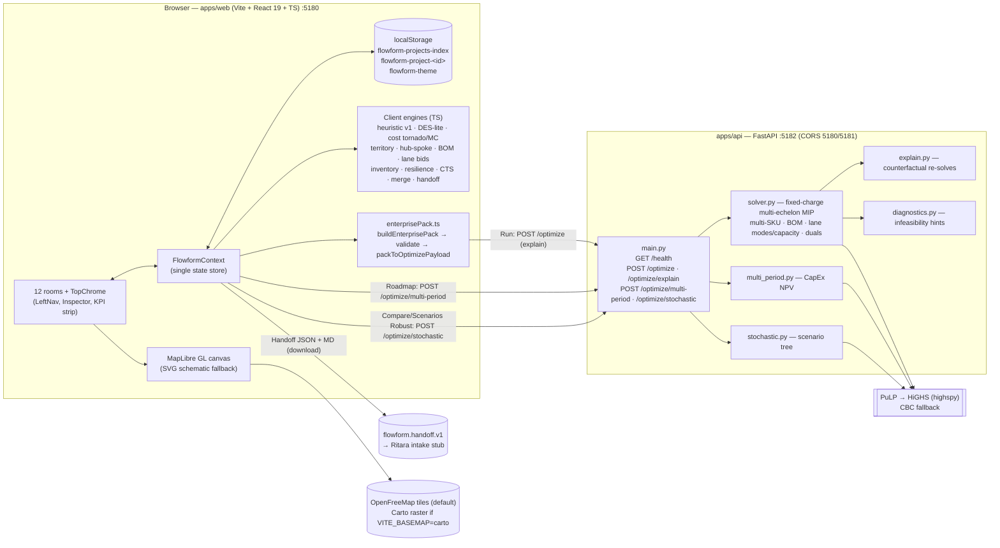

# Flowform — Master Blueprint

**Codename:** Flowform · supply-chain network **design** studio
**Owner:** Jigar Parekh
**Repo:** `jigarparekh84-lab/Flowform` (private) · branch `master` · written against HEAD `1b2afc2` (Oct 17, 2026)
**Status:** Living document. **Replaces** `docs/PRODUCT_BLUEPRINT.md` and extends `docs/UX_BRIEF.md` (both written Sep 28, 2026, before the optimizer depth work). Those files stay for history; read this one first.
**Companion:** [`MANUAL_TEST_WORKBOOK.md`](MANUAL_TEST_WORKBOOK.md) (full manual QA) · [`SMOKE_CHECKLIST.md`](SMOKE_CHECKLIST.md) (quick smoke)

> **How this document was checked.** Every feature, field, and number here was read from the code at `1b2afc2` or captured by running it. The API was started with `uvicorn` and called with the same payloads the web app builds. The payloads came from the app's own TypeScript builders (`buildEnterprisePack` → `packToOptimizePayload`). Values marked **(captured)** came from those runs. The headline numbers were reproduced on the Mac (`/Users/jigar/Projects/Flowform`, Python 3.14) and on a Linux box (Python 3.13). Section 11 lists the gaps and defects found along the way.

---

## Contents

1. Product vision and positioning
2. Personas
3. Architecture
4. Data model
5. Rooms (12) and global chrome
6. Optimizer capabilities and API
7. Explainability
8. Sample datasets and reference numbers
9. Run instructions
10. Testing assets
11. Known limitations and defects found
12. Roadmap
13. Depth-slice commit map

---

## 1. Product vision and positioning

**One-liner.** Flowform is a map-first studio for drawing, optimizing, stress-testing, and explaining a supply-chain **footprint**: which plants, DCs, and lanes to run, and at what capacity. The finished design goes to a planning system as a structured package.

**Problem.** Decisions about where plants and DCs go, which lanes to run, and how much capacity to commit tend to live in spreadsheets or deep inside planning tools. Teams need a design surface that comes before planning, and it has to be quantitative (MIP), explainable (why each site is open or closed), and scenario-native.

**Positioning: network design vs day-to-day planning.**

| | **Flowform (network design)** | **Day-to-day planning / APS (e.g. Ritara)** |
|---|---|---|
| Question | *What network should we have?* Sites, lanes, capacity, territory, CapEx timing | *How do we run the network we have?* Orders, schedules, MRP, execution |
| Horizon | Strategic (Y0–Y5 roadmap, FY26–FY28 horizon picker) | Tactical/operational (days–weeks) |
| Decisions | Open/close/expand facilities, lane mode and capacity, service radius, product capability | Supply/demand balancing, sequencing, replenishment |
| Engine | Fixed-charge multi-echelon MIP (PuLP + HiGHS), multi-period NPV, scenario-tree robust, plus client heuristics (DES-lite, sensitivity, territory, hub-spoke) | APS solvers (out of scope) |
| Surface | Map canvas, scenarios, compare, brief | Plan grids, order books |
| Exit | **Handoff** package `flowform.handoff.v1` (JSON + Markdown ops brief) | Consumes the package (intake adapter: future work) |

**Non-goals (still true in code).** No APS, scheduling, or MRP. No embedded or copied Ritara code: the Ritara link is a JSON **contract stub** only (`target: "Ritara APS (intake contract)"`). No live sync. No multi-tenant auth.

**Design principles** (from `UX_BRIEF.md`, still valid): the canvas owns the viewport, spatial comes before tabular, scenarios sit next to the map, you compare without losing your place, greenfield is a mode rather than another app, handoff is an exit ramp, and advanced controls use progressive disclosure.

---

## 2. Personas

| Persona | Goals in Flowform | Primary rooms |
|---|---|---|
| **Network design lead** (primary) | Build or load a footprint, run the MIP, read why each site is open or closed, compare what-ifs, recommend one | Network, Scenarios, Compare, Brief |
| **Ops strategy / IBP reviewer** | Challenge the recommendation: sensitivity, robustness, service risk, territory | Compare (Sensitivity, Robust, DES-lite, Resilience), Brief |
| **Finance / CapEx partner** | Phase CapEx, read NPV, see objective breakdown and $M units | Roadmap, Compare (objective breakdown), Brief |
| **Data / analytics engineer** | Load enterprise data, fix validation codes, run stress benchmarks | Data, Projects, API (`curl`, `pytest`) |
| **Downstream planner** (Ritara / S&OP) | Receive a clean design package: sites, lanes, preferred territory, CapEx calendar, mix, BOM RM, inventory targets | Handoff (consumer of JSON/MD) |
| **M&A integration analyst** | Merge an acquired network, resolve id conflicts, draft a merged baseline | Merge |

---

## 3. Architecture

### 3.1 System diagram



### 3.2 Run pipeline (top-chrome **Run**)

1. `checkApiHealth()`: `GET /health` with a 1.2 s timeout.
2. `buildEnterprisePack()` from live state (network, constraints, product mix, BOM, emission factors), then `validateEnterprisePack()` produces the scorecard, and `packToOptimizePayload()` builds the MIP payload: one SKU per product group (`sku-<group>`), `demandByProduct`, `bomDemand`, `costFactors`.
3. If the API is up, it calls `POST /optimize` with `explain: {maxCounterfactuals: 12, budgetSec: 30}` and `reference` = the Baseline scenario.
4. `applyOptimizeResult()` creates a new scenario named **"Optimize MIP <time>"** (or **"Optimize Infeasible <time>"**). It stores `optimizeMeta` (objective breakdown, flows, duals, explain, lane utilization, product breakdown, infeasibility report), applies open/close decisions to constraints (skipped when infeasible), and appends a `run_optimize` decision-log entry.
5. If the API is down or errors, it falls back to `runHeuristicOptimize` (greedy, "Heuristic v1 — greedy open/close (not a full MIP)").

The status line in the chrome shows: `API pulp-highs · Optimal · <s> · fixed-charge-multi-echelon-v1 · service x% · obj $…M (tx … + CapEx … + OpEx …) · N SKUs/groups · modes … · K binding lane cap(s)`. Chips show model, status (red when Infeasible), solve seconds, solver, SKU count, and the first infeasibility code.

### 3.3 Repository layout (HEAD `1b2afc2`)

| Path | Role | Size |
|---|---|---|
| `apps/web/src/App.tsx` | Room router, global keys (Esc, ?) | 97 lines |
| `apps/web/src/state/FlowformContext.tsx` | All studio state + actions (run/optimize/robust/multi-period, scenarios, log) | 2,668 |
| `apps/web/src/components/*` | 28 room/panel components (Compare 3,242; Data 1,394; NetworkMap 764; Roadmap 789; Handoff 728; Inspector 716) | — |
| `apps/web/src/data/*` | Domain engines + types (enterprisePack 1,713; sampleNetwork 1,016; bom 819; handoffPackage 773; capexRoadmap 725; serviceTerritory 703; optimizeApi 617) | — |
| `apps/web/public/samples/` | `na-footprint-2027.flowform.json`, `stress-120/200-demand.enterprise.json` | — |
| `apps/api/app/solver.py` | Fixed-charge multi-echelon MIP | 2,489 |
| `apps/api/app/{explain,multi_period,stochastic,diagnostics}.py` | Explain / NPV / robust / hints | 593 / 722 / 725 / 299 |
| `apps/api/tests/` | 54 pytest cases (smoke, depth 4/7/8, multi-period, stochastic, stress benchmark, cost scaling) | — |
| `docker-compose.yml`, `.github/workflows/ci.yml` | web :5180 + api :5182; CI = `npm ci && npm run build` + `pytest -q` | — |

**Persistence.** Projects live only in browser `localStorage`: `flowform-projects-index`, `flowform-active-project-id`, and `flowform-project-<id>` (a `ProjectSnapshot`). The theme is stored in `flowform-theme`. There is no server-side storage.

---

## 4. Data model

### 4.1 Enterprise pack — `flowform-enterprise-pack` @ `enterprise-data-v1`

Defined in `apps/web/src/data/enterprisePack.ts`. The pack is the canonical import/export format and the only path into the MIP (Run rebuilds a pack from studio state every time).

| Entity | Key fields | Notes |
|---|---|---|
| `sites[]` | `id, name, kind (plant/dc/demand/supplier/candidate), lat, lng, x, y, region, capacityMin, capacityMax, fixedCostM, fixedOpexM?, status (open/closed/candidate), capableProductIds?, capacityByProduct?` | `fixedCostM` = CapEx $M to open (0 if sunk). Demand sites are the "customers". |
| `skus[]` | `id, name, code, groupId?, handling?` | |
| `productGroups[]` | `id, name, code, color?, description?` | Catalogs: Ambient/Chilled/Hazmat or Finished/WIP/RM |
| `demand[]` | `id, customerId, skuId, volume` | Demand by SKU × customer |
| `lanes[]` | `id, from, to, mode, costPerUnit ($/unit), leadDays, capacity, co2Kg?, modes[]?` | `modes[] = {mode, costPerUnit, leadDays, capacity?, co2KgPerUnit?, fixedCostM?}`. Known modes: Truck, Rail, Intermodal, Ocean, Air, Parcel |
| `bom[]` | `id, parentSkuId, childSkuId, qtyPerUnit, plantId?, supplierId?` | Becomes `bomDemand` supplier→plant arcs |
| `costFactors` | `emissionKgPerTonMileByMode, transportCostScale, offLanePremium (1.35), offLaneRatePerUnitMile?, uncoveredPenaltyPerUnit (15)` | Legacy `uncoveredPenaltyM` is ignored by the solver |
| `globals?` | `serviceTargetPct, serviceRadiusMiles, capexBudgetM, maxFacilities, hardServiceConstraints, maxLeadTimeDays, aggregateProductsByGroup, maxProductCommodities, enforceLaneCapacity, carbonPricePerTonne` | Optimize globals carried with the pack |

**Validation scorecard** (`validateEnterprisePack`). Fields: `ok, score, errorCount, warnCount, infoCount, geocodeCoveragePct, siteCount, demandRowCount, demandVolumeTotal, laneCount, skuCount, bomRowCount, orphanDemandCount, missingEndpointCount, capacityIssues, bomCycleDetected, multiModeLaneCount, laneModeOptionCount, issues[] {level, code, message, entityId, hint}`.

**Score formula:** `100 − 12·errors − 3·warns − (100 − geocode%)/4 − 15 (if BOM cycle)`, clamped to 0–100. `ok = errors == 0 && sites > 0`. Import is **blocked** when `errorCount > 0`; warnings load.

**Validation codes (38).** Severity was captured by running each negative case through `parseEnterprisePackJson` (see workbook WF08):

| Code | Level (captured) | Code | Level (captured) |
|---|---|---|---|
| `EMPTY_PACK` | error | `LANE_MODE_EMPTY` | flagged |
| `SCHEMA_MISMATCH` | warn | `LANE_MODE_UNKNOWN` | warn |
| `DUPLICATE_SITE_ID` | error | `LANE_MODE_DUPLICATE` | flagged |
| `UNKNOWN_SITE_KIND` | flagged | `LANE_MODE_COST_NEGATIVE` | flagged |
| `INVALID_SITE_STATUS` | flagged | `LANE_MODE_LEAD_INVALID` | flagged |
| `GEOCODE_GAP` | warn | `LANE_MODE_CAPACITY_NONPOSITIVE` | flagged |
| `CAPACITY_NONPOSITIVE` | error | `LANE_MODE_FIXED_COST_NEGATIVE` | flagged |
| `CAPACITY_MIN_GT_MAX` | error | `LANE_MODE_CO2_NEGATIVE` | flagged |
| `FIXED_COST_NEGATIVE` | flagged | `LANE_MODE_CAPACITY_BELOW_LANE` | flagged |
| `DUPLICATE_GROUP_ID` | flagged | `LANE_ROUTE_DUPLICATE` | warn |
| `DUPLICATE_SKU_ID` | flagged | `DUPLICATE_BOM_ID` | flagged |
| `ORPHAN_SKU_GROUP` | flagged | `BOM_ORPHAN_PARENT` | flagged |
| `DUPLICATE_DEMAND_ID` | flagged | `BOM_ORPHAN_CHILD` | flagged |
| `ORPHAN_DEMAND_CUSTOMER` | error | `BOM_QTY_NONPOSITIVE` | flagged |
| `ORPHAN_DEMAND_SKU` | error | `BOM_CYCLE` | error (−15 extra) |
| `DEMAND_VOLUME_NONPOSITIVE` | error | `BOM_PLANT_MISSING` | flagged |
| `DUPLICATE_LANE_ID` | flagged | `BOM_SUPPLIER_MISSING` | flagged |
| `LANE_FROM_MISSING` / `LANE_TO_MISSING` | error | `LANE_COST_NEGATIVE` | error |
| `LANE_CAPACITY_NONPOSITIVE` | flagged | | |

"flagged" means the code exists and is covered by `enterprisePack.test.ts` (12/12 pass) but its level was not captured separately.

### 4.2 Project snapshot — `flowform-project` v1

`ProjectSnapshot` keys (from the sample pack): `version, horizon, scenarios, activeScenarioId, deltas, network, constraints, brief, handoffPayload, emissionFactors, lastCandidates, theme, inventoryPolicies, comments, productMix, laneRates, bom, capexRoadmap, decisionLog`. The export file is `{format: "flowform-project", version: 1, meta: {id, name, createdAt, updatedAt}, state}`.

**Constraints** (`NetworkConstraints`): globals (`serviceTargetPct 95, serviceRadiusMiles 250, capexBudgetM 30, maxFacilities = clamp(#facilities, 3, 8)`, optional `hardServiceConstraints, maxLeadTimeDays, aggregateProductsByGroup, maxProductCommodities`) plus `facilities[] {nodeId, status, capacityMin, capacityMax, fixedCapexM}`. Defaults from `defaultConstraintsFromNetwork`: **min = 60 % and max = 125 % of nominal capacity**, CapEx 8 (plant), 4 (DC), or 6 (candidate) $M.

**Scenario.** `{id, name, tag, kpis {cost, service, capex, co2, risk, inventory?, invUnits?}, optimizeMeta?, desLite?, costSensitivity?, resilience?, …}`. Optimize results arrive as new scenarios. Baseline KPIs are hard-coded: **$48.2M · 94.1 % · $0 · 12.4 kt · Med**.

### 4.3 Units

- **All money is $M.** Lane `costPerUnit` is **$ per physical unit**. One model volume unit = **1,000 physical units**, so demand `9200` means 9.2M units and explain text prints physical units.
- **Off-lane arcs** (no lane, inside the radius) cost the median lane $/unit-mile × `offLanePremium` (default **1.35**). The fallback is $0.0015/unit-mile when no lanes are rated.
- **Unmet demand** costs `uncoveredPenaltyPerUnit` = **max($15, 10 × median lane $/unit)**. It is reported separately as `uncoveredPenaltyM`.

### 4.4 Handoff package — `flowform.handoff.v1`

Top-level fields: `schema_version, product ("Flowform"), target ("Ritara APS (intake contract)"), readme (embedded), meta, brief, network {sites, lanes, demand_volume, site_count, lane_count}, preferred_lanes, territory, capex_events, capex_year_slices, product_mix, bom {rows, fg_shares, implied_rm, rollup}, inventory_targets, scenarios, section_counts`. Files: `flowform-handoff-<horizon>-flowform.handoff.v1.json` and `flowform-handoff-ops-<horizon>.md`. **It is a contract stub. No Ritara code and no live API.**

---

## 5. Rooms (12) and global chrome

Nav order in code (`LeftNav.tsx`): **Projects · Network · Greenfield · Hubs · Territory · Roadmap · Scenarios · Compare · Brief · Data · Merge · Handoff**. The app opens on **Network**.

### 5.0 Global chrome (TopChrome)

| Control | Behavior |
|---|---|
| Project button | Opens Projects; shows the active project name |
| `Active · <scenario>` chip | Current Active scenario |
| Horizon | FY26 / FY27 / FY28 |
| Run status | Progress bar while running. When done: message, model, status, seconds, solver, SKU count, infeasibility chip (hover lists all hints) |
| ☀ Light / ☾ Dark | Toggles `data-theme` on `<html>`; persisted in `flowform-theme`; first default follows `prefers-color-scheme` |
| **Run** | API MIP if reachable, otherwise heuristic v1 |
| **Share** | Copies a `flowform://share?v=1&project=…&name=…&readonly=1` deep-link stub and downloads `<name>.share.json` (`format: flowform-share`). An alert confirms. |
| **Compare** | Jumps to Compare |
| **Help ?** | Opens the keyboard shortcuts dialog |
| Search ⌘K | Command palette **stub** (no action) |

**Keyboard** (`App.tsx`, `KeyboardHelp.tsx`): `Esc` closes help, otherwise clears the map/table selection. `?` toggles help. Shift+click multi-selects nodes or lanes. Clicking the map background clears the selection. Shortcuts are ignored while typing in inputs, textareas, selects, or contenteditable elements.

### 5.1 Projects

- **Purpose:** workspace home for design studies.
- **Inputs:** `*.flowform.json` imports; stress packs.
- **Outputs:** an Active project; `*.flowform.json` export; decision log panel.
- **Key controls:** New project · Import JSON · Load stress-200 · Load stress-120 · Open · Rename (Save/Cancel) · Duplicate · Export · Delete. Delete is disabled with the tooltip "Keep at least one project" when only one project exists.

### 5.2 Network (primary canvas)

- **Purpose:** design and inspect the active footprint on a map.
- **Inputs:** network, constraints, product mix, BOM, last MIP result.
- **Outputs:** edited nodes, lanes, and constraints; selection; KPIs.
- **Key controls:**
  - **Layer rail:** Plants, DCs, Demand, Suppliers (off), Lanes, Service radii (off), Candidates, Capacity heat (off), Territory (off).
  - **Map:** MapLibre with OpenFreeMap (`styles/liberty` light, `styles/dark` dark), or the Carto raster style. Tiles/SVG toggle with SVG schematic fallback.
  - **Lane paint:** selected `#7dd3fc` → MIP binding **red `#f87171`** → MIP util ≥ 80 % **amber `#fbbf24`** → BOM lanes `#c084fc` → default.
  - **Inspector, node:** name/type/region/capacity, demand product mix, product capabilities, BOM production and outbound, and the **"Why this site?"** explain card (after an API run). Facility rows: Status (Open/Closed/Candidate), Capacity min/max, Open CapEx $M.
  - **Inspector, lane:** cost/unit, lead time, CO₂, lane product groups, **Transport mode** (changing it rescales cost by mode relatives: Road/Truck 1, Rail 0.55, Intermodal 0.72, Ocean 0.32, Air 4.5, and refreshes CO₂), and carrier bids (Cheapest/Fastest/Balanced, Apply, Add bid, Apply winner).
  - **Inspector, nothing selected:** **Network constraints**: Service radius (mi), CapEx budget ($M), Max facilities, **Hard service constraints**, Max lead-time (days, optional).
  - **Product group filter:** All / per group; dims entities outside the group.
  - KPI strip, bottom Facilities/Lanes tables, scenario footer (**+ New** is a stub).

### 5.3 Greenfield

- **Purpose:** blank-slate candidate DC placement (a mode, not a separate app).
- **Inputs:** Demand set (NA Core demand (sample); East-heavy growth (stub); West Coast push (stub)), site count 2–6 (default 3), service miles (250), Euclidean distance, Lock existing sites.
- **Outputs:** Candidates table (Name, Region, Score, Reach) and a mini-map. **Promote → Candidates delta** goes to the Scenarios delta library.
- **Note:** candidate placement is a **mock heuristic** (`generateCandidates`) that runs on the static sample `NODES`, not the MIP. Composed-scenario KPIs come from a formula (`kpisForComposedScenario`).

### 5.4 Hubs (hub-and-spoke)

- **Purpose:** designate hubs, assign demand spokes, generate hub→spoke lanes, and draft a before/after scenario.
- **Key controls:** Suggest 2 hubs / Suggest 3 hubs; Assign spokes by (distance / volume / balanced, volume weight 0.45); New lane mode (Truck); Replace existing demand-inbound lanes; Draft scenario name; **Apply + draft scenario**.
- **Outputs:** Before (Active) vs After (preview) KPIs, Hub loads (util %), Spoke assignments, and the decision log entry `apply_hub`.

### 5.5 Territory

- **Purpose:** assign demand to serving DCs and plants, measure coverage, find gaps and overlaps, and apply preferred inbound lanes.
- **Key controls:** Select all servers; Assign by (**distance / capacity / lanes**); coverage miles (400) and lead days (3); New lane mode; Scenario name; **Apply as scenario + update preferred lanes**.
- **Outputs:** After KPIs, territory load vs capacity, assignments with status (assigned/overlap/gap), map territory colors and gap/overlap ring, and the log entry `apply_territory`. The same view appears in Compare → Territory.

### 5.6 Roadmap (CapEx phasing)

- **Purpose:** multi-year open/close/expand events with CapEx and capacity Δ, plus NPV timing optimization.
- **Inputs:** Base year label (FY26), Years (2–8, default 6 → Y0–Y5), events (Kind, Year, Facility, Name, CapEx $M, Capacity Δ).
- **Key controls:**
  - **Optimize timing** (Call API `/optimize/multi-period`): Mode = Choose timing (NPV) / Force timeline; Discount rate % (10).
  - **Apply year slice** (Through year; Scenario name → Apply as scenario).
  - **Export to Brief** / **Export NPV to Brief**; Reset sample.
- **Outputs:** Gantt-lite timeline, cumulative CapEx & capacity table, Multi-period NPV results (NPV total, CapEx/OpEx/Transport NPV, per-year rows), timing written back to events, and log entry `optimize_timing`.

### 5.7 Scenarios

- **Purpose:** library of what-ifs, presets, and composition.
- **Key controls:**
  - **Sensitivity presets:** Fuel +20%, Demand shift East, Node outage (DC), Tariff / duty (MX inbound). Each creates a new what-if from Active.
  - **Cost tornado + Monte Carlo** (Run on Active).
  - **Robust optimize:** Objective Expected cost / Minimax / CVaR-lite; Export to Brief. It uses library scenarios as shocks when 2 or more exist.
  - Network scenarios list (activate), Delta items, **Compose** (Scenario name, Base + promoted greenfield deltas).

### 5.8 Compare

- **Purpose:** side-by-side KPIs and diagnostics versus a Reference. Up to **5** scenarios; defaults to Baseline + Active.
- **Tabs (14):** Matrix · Map diff · Waterfall · Cost-to-serve · DES-lite · Sensitivity · Inventory · Resilience · Mode mix · Products · Bids · BOM · Territory · **Robust**.
- **Matrix extras:** *Optimize objective breakdown* (Total, Transport, CapEx, OpEx, Uncovered pen., Open sites, Model) · *Optimized flows by mode · lane capacity* (mode mix + binding lane caps with π) · **Why this network — <scenario>** explain panel · *Infeasibility diagnostics* · *SKU / product-group breakdown*.
- **Also present:** Comments panel and decision log panel.

### 5.9 Brief

- **Purpose:** the Decision Brief: recommendation vs Reference, scenario cards, assumptions checklist, and notes.
- **Key controls:** Recommended scenario; **Download Markdown** (`flowform-brief-<horizon>.md`); **Printable HTML** (`flowform-brief-<horizon>.html`); **Send to Handoff**; assumptions (6 defaults, 5 checked); Notes.
- **Explain:** "Why this network" uses MIP explain when present. Otherwise it shows the hint "run Optimize with the API online…".
- **Also present:** decision log and comments panels.

### 5.10 Data

- **Purpose:** get data in, validate it, and edit reference data.
- **Sections:**
  - **Uploads:** Sites / Demand / Lanes CSV templates (Template download), Load into Network, Reset to sample, Restore sample network.
  - **Enterprise data model:** Export pack JSON, Import pack JSON, Load stress-200/120. **Validation scorecard** (schema, score, geocode, demand/lanes, issues with fix-it hints).
  - Constraints linked to Network.
  - **Product / commodity groups:** catalog switch, demand mix by node, facility capabilities, lane product tags.
  - **Lane rate tables & bids:** strategy, bids by corridor, Apply / Apply all winners / Reset rates.
  - **Bill of materials:** FG demand shares, BOM rows, implied RM, echelon flows, Highlight BOM lanes, Draft inbound scenario, Reset sample.
  - **CO₂ emission factors** (kg/ton-mile).

### 5.11 Merge

- **Purpose:** M&A merge studio.
- **Key controls:** Load sample acquired / Import network JSON; Sources (Primary, Acquired, Merged preview); Conflicts table with Resolution (Keep both (rename acquired) / Keep primary only / Replace with acquired); **Apply merge + draft scenario**.

### 5.12 Handoff

- **Purpose:** the S&OP design exit ramp toward Ritara (stub).
- **Inputs:** the Brief (shows "Waiting for Brief" until Brief → Send to Handoff).
- **Outputs:** Package ready + schema; **Download JSON**; **Ops brief (Markdown)**.
- **Section tabs:** overview, network, preferred lanes, territory, CapEx, products, BOM, inventory, scenarios, README, raw JSON preview. Log entry `handoff_export`.

---

## 6. Optimizer capabilities and API

### 6.1 Endpoints (FastAPI `0.7.0`, port 5182)

| Method | Path | Purpose | Errors |
|---|---|---|---|
| GET | `/health` | `{"status":"ok","service":"flowform-api","model":"fixed-charge-multi-echelon-v1+multi-period-capex-npv-v1+stochastic-scenario-tree-v1+explain-v1"}` | — |
| POST | `/optimize` | Single-period MIP (optional `explain`) | 422 schema (e.g. missing `constraints`); 400 `ValueError` (e.g. "No facility nodes (dc/plant/candidate) in network."); 503 solver missing; 500 other |
| POST | `/optimize/explain` | Same as `/optimize` with `explain` forced on | same |
| POST | `/optimize/multi-period` | CapEx NPV timing | 400 ("No demand nodes in network.") |
| POST | `/optimize/stochastic` | Scenario-tree / robust | 400 ("Need 2–5 scenarios, got 1.") |

### 6.2 `POST /optimize`: fixed-charge multi-echelon MIP (`fixed-charge-multi-echelon-v1`)

**Model.**
- Binary open/close per decidable facility (DCs and candidates; plants when `optimizePlants`). Fixed CapEx (if not already open) + OpEx; capacity max and min-throughput-when-open (`capacityMin`).
- Flow conservation supplier→plant (BOM `qtyPerUnit`), plant→DC, DC→customer, and plant→customer, **per commodity**.
- Arcs exist within `serviceRadiusMiles`, or wherever an explicit lane exists (lanes override the radius).
- Budget (`capexBudgetM`) and `maxFacilities` (counts DCs/candidates). Unmet demand is penalized (soft) or forbidden (`hardServiceConstraints`).
- `maxLeadTimeDays` cuts slow arcs and modes.

**Multi-SKU.** `network.demandByProduct` + `skus`/`productGroups`. Products aggregate to groups automatically when the commodity count exceeds `maxProductCommodities` (default 8; `aggregateProductsByGroup` auto/always/never). Facility `capableProductIds` accepts SKU or group ids (expanded via `groupId`).

**Lanes and modes (depth 7).**
- `lanes[].capacity|capacityUnits` and `lanes[].modes[]`; the MIP chooses the split.
- Per-mode $/unit, transit, CO₂/unit, capacity, and an optional fixed activation charge (binary).
- `enforceLaneCapacity` (default true), `carbonPricePerTonne`, `tonsPerUnit`, `emissionKgPerTonMileByMode`.
- Duplicate `from→to` rows with different modes become alternatives.

**Request highlights.** `network {nodes, lanes, demandVolume, demandByProduct?, skus?, productGroups?, bomDemand?, costFactors?}`, `constraints {globals + facilities[]}`, `reference?`, `bom?`, `bomDemand?`, `enterpriseSchemaVersion?`, `explain?` (`true` or `{maxCounterfactuals (12, max 50), timeLimitSec, budgetSec (60), topDecisions (6)}`).

**Response highlights.**

| Field | Contents |
|---|---|
| `ok, status, solver ("pulp-highs"), model, solveSeconds` | Solve metadata |
| `openIds / openedIds / closedIds / keptOpenIds` | Decisions |
| `openFacilities[]` | Throughput, capacityMax, util %, CapEx/OpEx, capable products |
| `flows[]` | `from, to, volume, miles, unitCost, transportCostM, echelon, productId, laneId, mode, leadDays, co2Kg` |
| `objectiveBreakdown` | `totalM, transportM, fixedCapexM, fixedOpexM, uncoveredPenaltyM, laneFixedM, carbonM, modeMix[], currency` |
| `costScale` | median lane rate, off-lane rate + source, penalty + source |
| `shadowPrices[]` | `facilityId, shadowPrice, binding, slack, method ("lp-dual")` |
| `kpis` | `servicePct, capexUsedM, opexUsedM, transportCostM, costM, co2Kt, uncoveredDemand, targetPct, objectiveTotalM, productCount, transportCo2Kt, bindingLaneCount` |
| `productBreakdown[]` | Per SKU/group demand, served, service %, transport |
| `laneFlows, laneUtilization, laneCapacity, bindingLaneCapacities, laneCapacityShortfalls, modeChoice` | Depth 7 |
| `infeasibilityReport` | `{status, summary, hints[{code, severity, message, entities, hint}], metrics, method: "structural-best-effort", note}` |
| `explain` | Depth 8 (see §7) |
| `log[]` | Model size, solver, status, summary lines |

**Infeasibility hint codes:** `UNREACHABLE_DEMAND, SERVICE_RADIUS_TOO_TIGHT, CAPACITY_SHORTFALL, NO_CAPABLE_FACILITY, PRODUCT_CAPACITY_SHORTFALL, HARD_SERVICE_INFEASIBLE, LANE_CAPACITY_SHORTFALL, MODE_SERVICE_CAPACITY_CONFLICT, PLANT_OUTBOUND_LANE_SHORTFALL` (plus `MULTI_PERIOD_INFEASIBLE`, `STOCHASTIC_INFEASIBLE`). Best effort; no full IIS.

### 6.3 `POST /optimize/multi-period` (`multi-period-capex-npv-v1`)

- **Request:** `/optimize` body plus `roadmap {baseYearLabel, yearCount (2–8), discountRate (0–0.5, default 0.10), mode: choose_timing | force_timeline, events[{id, kind open|expand|close, year, nodeId, capexM, capacityDelta, earliestYear, latestYear, locked}], demandScaleByYear? | demandGrowthPct?, hardServiceConstraints?, capexBudgetTotalM?, enforceCapexBudget}`.
- **Model:** one timing binary per event and year; capacity in year t = cumulative opens and expands − closes.
- **Objective:** minimize NPV(CapEx + OpEx + transport + uncovered).
- **Materialization:** open events whose node is missing from the network are materialized as DC nodes.
- **Response:** `npv {totalM, capexNpvM, opexNpvM, transportNpvM, uncoveredPenaltyNpvM}`, `eventTiming[]`, `years[] {openIds, capexM, opexM, transportM, totalCostM, npvContributionM, servicePct, flowsSummary}`, `kpis`, `log`, `infeasibilityReport?`.
- **The web sends** the raw network (no SKU/BOM), `enforceCapexBudget: false`, and windows `[0, yearCount−1]` (choose) or `[year, year]` locked (force).

### 6.4 `POST /optimize/stochastic` (`stochastic-scenario-tree-v1`)

- **Request:** `/optimize` body plus `scenarioTree {objective expected|minimax|cvar_lite, cvarAlpha (0.3), computeEvpi (true), scenarios[2–5] {id, name, probability, demandScale, costScale, demandVolume?}}`. The shorthand `scenarios` + `objective` at the top level is also accepted.
- **Model:** first-stage open/close is **shared**; second-stage flows are per scenario.
- **Objectives:** expected = fixed + Σ p·(transport + uncovered); minimax = worst; CVaR-lite = (1−α)·E + α·worst.
- **Response:** `firstStage {openIds, capexM, opexM, fixedCostM}`, `scenarios[] {transportM, uncoveredPenaltyM, totalCostM, servicePct, openIds, flowsSummary}`, `objectiveValueM, expectedCostM, worstCostM`, `evpi {hereAndNowExpectedM, waitAndSeeExpectedM, evpiGapM, waitAndSeeByScenario[]}`.
- **Web defaults:** Base 0.4 ×1.0 · Soft −15% 0.3 ×0.85 · Surge +25% 0.3 ×1.25. Compare and Scenarios can instead map scenario chips to shocks by name: fuel → cost ×1.2, demand/shift → demand ×1.15, outage → cost ×1.05, tariff/duty → cost ×1.1, baseline → ×1.0, others → spreads 0.9/1.0/1.1/1.2/0.95.

### 6.5 Client-side engines (no API)

| Engine | File | What it does | Defaults |
|---|---|---|---|
| Heuristic v1 | `optimize.ts` | Greedy open/close fallback when the API is down | radius from constraints |
| DES-lite | `desLite.ts` | Monte Carlo fill rate / late % / lead | 200 trials, demand noise 15 %, lead noise 20 %, target 5 d, seed 42 |
| Cost tornado + MC | `costSensitivity.ts` | OAT tornado + MC on 6 drivers vs the cost KPI | 300 trials, seed 42; ranges transport 15 %, fuel 20 %, tariff 25 %, demand 15 %, facility fixed 12 %, inventory holding 20 % |
| Inventory | `inventoryPolicy.ts` | Safety stock: ASCM combined (default) or simple z·σ·√LT | per-node policies |
| Resilience | `resilience.ts` | SPOF scoring via coverage drop | threshold = service target (95) |
| Territory | `serviceTerritory.ts` | Distance / capacity / lanes assignment | 400 mi, 3 d |
| Hub-spoke | `hubSpoke.ts` | Spoke assignment + lane generation | balanced, w = 0.45 |
| BOM | `bom.ts` | Implied RM, echelon flows, inbound lanes | sample 3 FG / 6 rows |
| Lane bids | `laneRates.ts` | Rank bids Cheapest/Fastest/Balanced, apply | balanced |
| Cost-to-serve | `costToServe.ts` | Uses MIP flows when present (totals = transport + variable OpEx) | — |

---

## 7. Explainability

1. **Objective breakdown.** Transport / CapEx / OpEx / unmet penalty / lane fixed / carbon, all in $M, shown in the Compare Matrix and the Brief.
2. **Capacity duals.** These are real HiGHS row duals of `cap_<facility>`, taken from one pure LP with every binary fixed at its MIP value. Shown as "Capacity binding (100 % utilized): each extra unit of capacity saves $x/unit". A flat −0.08 proxy is used only when the solver gives no duals (CBC). Closed sites report `shadowPrice 0, closed: true`.
3. **Lane duals and binding lanes.** `bindingLaneCapacities[]` with π. Map lanes turn **red** when binding and **amber** at ≥ 80 % utilization. Compare shows *Optimized flows by mode · lane capacity*.
4. **Explain block (`explain`)**:
   - Top level: `enabled, method ("counterfactual-mip-resolve+lp-duals"), baseCostM, baseServicePct, gapToleranceM, headline, facilities[], topOpenedIds, topClosedIds, maxCounterfactuals, timing, note`.
   - Per facility: `decision (opened / kept-open / closed / kept-closed), fixed CapEx+OpEx, inbound/outbound transport, utilization, capacity dual, customers served + demand share, reachable demand %, cost-to-serve + share, landed cost + rank, counterfactual {flipTo, status, costM, deltaM, deltaPct, servicePct, operatingDeltaM, penaltyDeltaM, unservedDeltaUnits, alsoOpens, alsoCloses, lockLifted}, reasons[] (ranked, tone), headline`.
   - **Counterfactual:** the full MIP is re-solved with the facility forced to the opposite state (scenario lock lifted). All facilities are covered when there are ≤ 12; otherwise the top-N by impact, with at least ⅓ of slots reserved for closed candidates, bounded by `budgetSec`.
5. **UI surfaces:** Network Inspector "Why this site?" card · Compare Matrix "Why this network — <scenario>" (Open sites — top by flip cost; Closed sites — why not) · Brief "Why this network" plus a Markdown section (`explainMarkdown`, top 5 opened + top 5 closed).

**Captured example (built-in sample):**
- **Headline:** "The MIP closed Reno DC; kept 3 existing site(s) open. Costliest flip: closing Austin Plant strands 27.7M units (service 0.0%)."

| Site | Decision | Headline reason | Flip (captured) |
|---|---|---|---|
| Columbus DC (n2) | Kept open | "Required: closing it makes the network infeasible" | infeasible |
| Austin Plant (n1) | Kept open | "Closing it strands 27.7M units of demand (service drops to 0.0%); operating cost falls $98.3M only because that demand goes unserved" | +$317.23M total (incl. penalty) |
| Atlanta DC (n3) | Kept open | "Closing it raises cost by $850k (0.9%); service holds at 100.0%" | +$0.8504M |
| Reno DC (n8) | Closed | "No customers within service radius / lead-time limits" | +$0.70M to open |

---

## 8. Sample datasets and reference numbers

### 8.1 Built-in sample: "NA Footprint 2027"

| id | Name | Kind | Capacity | Region |
|---|---|---|---|---|
| n1 | Austin Plant | plant | 42k u/wk | South |
| n2 | Columbus DC | dc | 18k pallet | Midwest |
| n3 | Atlanta DC | dc | 14k pallet | Southeast |
| n4 | Chicago Hub | demand | 9.2k | Midwest |
| n5 | Dallas Metro | demand | 7.1k | South |
| n6 | NYC Corridor | demand | 11.4k | Northeast |
| n7 | Monterrey Sup | supplier | 22k | MX |
| n8 | Reno DC | dc | 12k pallet | West |

Lanes: l1 n7→n1 Truck $1.12 · l2 n1→n2 Rail $0.64 · l3 n1→n3 Truck $0.88 · l4 n2→n4 Truck $0.41 · l5 n3→n6 Intermodal $0.97 · l6 n1→n5 Truck $0.35 · l7 n8→n2 Rail $0.72 · l8 n3→n5 Truck $0.79 · **l9 n2→n6 Truck $1.38 (hazmat lane Columbus→NYC)**. Demand 27,700 model units (27.7M units). Product mix Ambient/Chilled/Hazmat. Atlanta is not hazmat-capable, which is why l9 matters. BOM: 3 FGs, 6 rows, all supplied from Monterrey to Austin.

**Captured Run (default sample, API up):**
- **Optimal**, objective **$98.2706M** = transport $95.6706M + CapEx $0 + OpEx $2.6M; unmet $0.
- **Service 100 %** (all 3 SKUs). Open n1, n2, n3; **closed n8 (Reno)**. Solve 0.003–0.008 s.
- Supplier→plant BOM inbound is $62.048M of transport (55,400 model units × $1.12).
- KPI card: cost **$98.3M (+103.9 % vs the hard-coded $48.2M baseline)**, service 100.0 % (+5.9 pp), CapEx $0M, CO₂ 17.0 kt (+37 %), Risk Low.

### 8.2 Sample project pack

`apps/web/public/samples/na-footprint-2027.flowform.json` (`flowform-project` v1, "NA Footprint 2027 (sample)") contains the built-in network, Baseline + East Coast DC / Nearshore MX / Lean Lanes, product mix, lane rates, BOM, CapEx roadmap (5 events), and inventory policies. It gives the same Run result as §8.1 (pytest `test_sample_network_solves_optimal_with_full_service_and_closes_reno`).

### 8.3 Stress packs (`enterprise-data-v1`)

| Pack | Sites | Demand rows | Volume | Lanes (multi-mode) | Globals | Captured Run |
|---|---|---|---|---|---|---|
| stress-120 | 132 (3 plants, 6 DCs, 2 candidates, 1 supplier, 120 demand) | 240 | 119,420 | 265 (24 with Truck/Intermodal/Rail = 72 options) | target 92 %, radius 400, budget $40M, max 10 | Optimal **$89.1208M** (tx $81.0008M, OpEx $7.8M, lane fixed $0.32M), 9 open, 100 %, 3 binding lanes (ln-10, ln-20, ln-22), modes Truck 59 % / Rail 36 % / Intermodal 4 %, solve 0.07–0.16 s |
| stress-200 | 212 (… 200 demand) | 400 | 197,500 | 425 (24 multi-mode / 72 options) | same | Optimal **$176.8117M** (tx $168.4817M, OpEx $7.8M, lane fixed $0.53M), **9 open** (6 DCs + 3 plants; candidates Seattle dc-7 and Miami dc-8 stay closed), 100 %, 6 binding lanes (ln-1, ln-10, ln-11, ln-20, ln-21, ln-22), modes Truck 61 % / Rail 34 % / Intermodal 6 %, solve 0.85 s (Mac) – 1.35 s (box); with explain (11 counterfactuals) ≈ 3.7 s wall |

---

## 9. Run instructions

```bash
# API (5182)
cd /Users/jigar/Projects/Flowform/apps/api
python3 -m venv .venv && source .venv/bin/activate && pip install -r requirements.txt   # first time
source .venv/bin/activate
uvicorn app.main:app --reload --host 127.0.0.1 --port 5182
curl -s http://127.0.0.1:5182/health

# Web (5180 — never 5173, which is Ritara)
cd /Users/jigar/Projects/Flowform/apps/web
npm install    # first time
npm run dev    # http://localhost:5180 ; preview build: npm run preview -> 5181

# Docker (both)
cd /Users/jigar/Projects/Flowform && docker compose up --build
```

**Environment (`apps/web/.env.local`, gitignored; never commit):** `VITE_API_URL` (default `http://127.0.0.1:5182`), `VITE_BASEMAP=openfreemap|carto`, `VITE_CARTO_API_KEY` (Carto only). Hard-refresh after changes.

**Tests:**
- `cd apps/api && pytest -q` → **54 passed** (captured).
- `pytest -q tests/test_stress_benchmark.py -s` → benchmark lines.
- `cd apps/web && npm run test:data` → enterprise 12/12, CTS 2/2.
- `npm run build` → green (one chunk-size warning).

---

## 10. Testing assets

- `docs/MANUAL_TEST_WORKBOOK.md` and `docs/Flowform_Manual_Test_Workbook.xlsx`: 20 workflows, 199 numbered test cases with expected values, a 16-check regression suite, and a defect log.
- `docs/SMOKE_CHECKLIST.md`: a 10-minute smoke that points to the workbook.
- CI (`.github/workflows/ci.yml`): web build + API pytest on push/PR to master/main.

---

## 11. Known limitations and defects found

### 11.1 Known gaps (confirmed in code)

1. **Baseline is hard-coded.** Optimize KPI deltas compare against Baseline `$48.2M / 94.1 % / 12.4 kt`. The `kpisFromApi` fallback uses the same numbers. The sample Run shows **+103.9 %**, which is meaningless as a delta.
2. **Multi-period and robust use a single lane rate with no mode choice.** They also send only the **raw network**, with no `demandByProduct` and no BOM. Their $ are therefore **not comparable** to Run: robust E[cost] is **$21.13M** vs Run **$98.27M** on the same sample.
3. **Supplier lanes have no mode choice.** BOM supplier→plant arcs carry no `laneId` or `mode` in flows.
4. **Per-product-group capacity is ignored with per-SKU products.** `capacityByProduct` is keyed by group id (`ambient`…) while commodities are `sku-<group>`, so `_capacity_by_product` never matches. Capability *is* expanded via `groupId`; capacity is not.
5. **Headless map worker warning** in non-GUI runs (MapLibre); cosmetic.
6. **Collaboration and auth are stubs.** Share deep link `flowform://…` has no receiver. Comments are local only. Search ⌘K and scenario footer "+ New" are stubs. No auth.
7. **Basemap.** OpenFreeMap today; move to **self-hosted Protomaps** before commercial launch.
8. **Greenfield and composed scenarios are mock heuristics**, not MIP-driven (`generateCandidates` uses static `NODES`; `kpisForComposedScenario` is a formula).
9. **Persistence is browser-only** (`localStorage`); there is no server store.

### 11.2 Defects and discrepancies found while writing this blueprint (logged in the workbook defect log)

| ID | Finding | Evidence (captured) |
|---|---|---|
| D-01 | **Roadmap → Optimize timing is Infeasible on the default sample roadmap**, in both choose-timing and force-timeline. The "Open Kansas City DC" event targets `roadmap-kc-dc`, which the API materializes as a DC **without status**, so it is treated as already open. Its open event is then forced to 0 (`no_reopen`) and to 1 (`once_ev`) at the same time. | `status: Infeasible`, hint `MULTI_PERIOD_INFEASIBLE`, log "Facility roadmap-kc-dc already open — open event(s) ignored in linkage." Without the KC event: choose_timing NPV **$111.9095M** (all events pushed to Y5); force_timeline **$116.4309M**. With KC passed as a `candidate` facility: **$119.7942M** / **$128.361M**. Reproduced on the Mac. |
| D-02 | **Removing l9 is diagnosed as `UNREACHABLE_DEMAND` even in soft mode.** The actual blocker is the facility **min-throughput** (`capacityMin` = 60 % of nominal). Columbus and Austin can't meet their minimums once NYC hazmat drops out, and the existing open plant is locked. | No-l9: Infeasible `UNREACHABLE_DEMAND n6/sku-hazmat` at target 95 or 90. Same payload with `capacityMin=0`: **Optimal, service 91.8 %, $122.7578M incl. $34.2M unmet penalty** (2,280 × $15). |
| D-03 | Lane-capacity infeasibility returns **no hints**. | l9 `capacityUnits=1000` → Infeasible, `hints: []`. |
| D-04 | **Robust keeps existing open sites forced open** (`stochastic.py` forces `status=open` non-candidates). On the sample, Reno stays open in every robust result, unlike Run. EVPI gap is $0.00 on default shocks. | firstStage opens n1, n2, n3, n8, OpEx $3.3M. |
| D-05 | **Carbon price magnitude looks inconsistent** with reported CO₂. | `carbonPricePerTonne=100` adds **$197.34M** carbon on the sample, while `transportCo2Kt` = 2.704 and the KPI `co2Kt` = 17.0. Units need review. |
| D-06 | `kpis.costM` excludes lane fixed charges. | stress-200 `costM` 176.3 vs `objectiveTotalM` 176.8117 (lane fixed 0.53) |
| D-07 | `maxFacilities` counts DCs/candidates only (plants excluded). This is undocumented. | sample `maxFacilities=2` still opens n1 + n2 + n3, $98.2706M |
| D-08 | Resilience on the Baseline scenario marks **all 4 facilities critical**, because baseline coverage (58.8 % within 250 mi) is already below the 95 % threshold. | score 10, critical n2 (−33.2 pp), n1 (−25.6 pp), n3, n8 (0 pp) |

---

## 12. Roadmap

**Now (stabilize the demo; from §11.2):**
1. Fix D-01: materialized open-event nodes should start closed (`status: candidate`), or the web should send the KC node as a candidate.
2. Fix D-02 and D-03: add `MIN_THROUGHPUT_CONFLICT` and lane-capacity hints to `diagnostics.py`, and surface the facility `capacityMin` in diagnostics.
3. Replace the hard-coded $48.2M baseline: compute the baseline by running the MIP with current open/close locked, store it on the Baseline scenario, and compute deltas from it.
4. Decide the robust policy for existing sites (D-04): allow closing when `optimizePlants`/decidable.
5. Audit the carbon-price units (D-05) and `costM` vs `objectiveTotalM` (D-06).

**Next (depth):**
6. Mode choice and the enterprise payload (SKUs, BOM) in `/optimize/multi-period` and `/optimize/stochastic`, so their $ match Run.
7. Supplier-lane mode choice; per-SKU capacity mapped through `groupId`.
8. MIP-backed Greenfield (candidate generation + open decision in the MIP).
9. Map: self-hosted Protomaps; fix the headless worker warning.

**Later (product):**
10. Auth, server-side project storage, real share links and comments.
11. Ritara intake adapter that consumes `flowform.handoff.v1` (contract only; no Ritara source copied).

---

## 13. Depth-slice commit map (verified in `git log`)

| Commit | Slice | Verified in code |
|---|---|---|
| `9316434` | Fixed-charge multi-echelon MIP + BOM + capacities + objective breakdown + shadow prices | `solver.py` |
| `16eed36` | `enterprise-data-v1` pack, validation codes, scorecard | `enterprisePack.ts` |
| `c2dce5c` | stress-120/200 packs, MIP benchmarks, CTS fidelity, solve status chips | `test_stress_benchmark.py`, `TopChrome.tsx` |
| `b3ae4b9` | Multi-SKU flows, hard service + max lead time, infeasibility diagnostics | `solver.py`, `diagnostics.py` |
| `b98c336` | `POST /optimize/multi-period` NPV, Roadmap Optimize timing | `multi_period.py`, `RoadmapStudio.tsx` |
| `650098f` | `POST /optimize/stochastic` (expected/minimax/CVaR-lite, EVPI) in Compare Robust + Scenarios | `stochastic.py`, `CompareResults.tsx`, `ScenariosLibrary.tsx` |
| `33863ee` | Lane capacity + Truck/Rail/Intermodal mode choice, lane duals, flows-by-mode panel, red/amber lanes | `solver.py`, `MipLaneModes.tsx`, `laneMip.ts` |
| `e516c51` | Explain cards, counterfactual flip cost, real facility duals, `POST /optimize/explain`, Inspector + Brief + Compare | `explain.py`, `ExplainCards.tsx` |
| `1b2afc2` | Feasible sample (hazmat lane l9), realistic cost scaling ($M; off-lane ×1.35; penalty max($15, 10× median)) | `test_demo_cost_scaling.py` |
